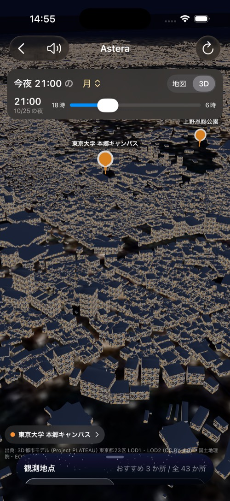
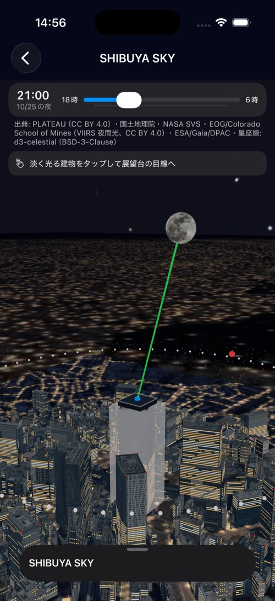
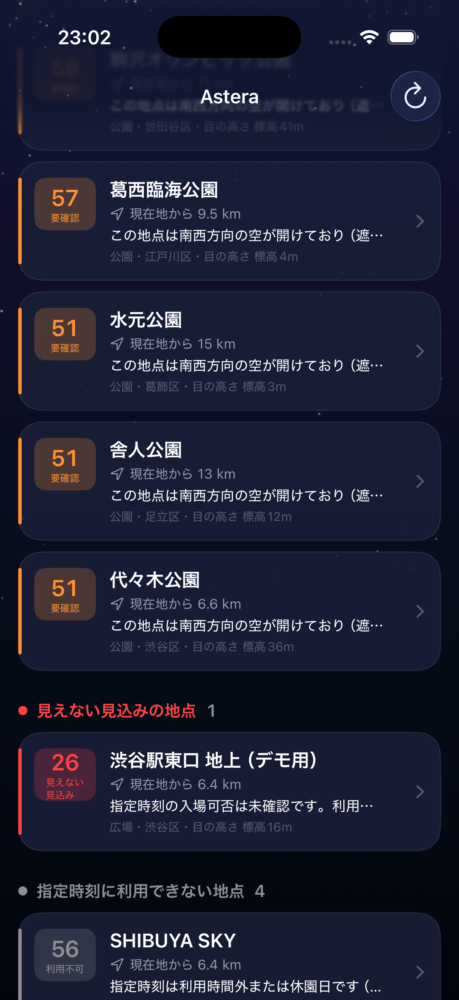

# Astera（アステラ）東京都23区 星空観測支援アプリ

**「今夜、どこへ行けば、どんな星空が見えるのか。」**

天気が良くても、東京ではビルに隠れて月や星が見えないことがある。Astera は、観測者の**目の高さ**と **3D 都市モデル（PLATEAU）** と**天体の位置計算**を組み合わせ、「この場所・この時刻に、その天体が建物に隠れず見えるか」を計算して、23区の観測地点を推薦する iPhone アプリ。

| ホーム（23区の3D・ピンを押すと詳細へ） | 詳細（全画面3D・時刻スライダー・引き上げシート） | 比較（地上と展望台） |
|---|---|---|
|  |  |  |

- 審査員の方へ: **[動かし方（シミュレータ／自分の iPhone）](#動かし方審査員向け)** に手順をまとめた
- 発表の冒頭に流す紹介動画の作り方は [video/README.md](video/README.md)（動画ファイルは容量のためリポジトリに含めていない）

## 製品概要

### 背景（製品開発のきっかけ、課題等）
都市部では、天気が良くても高層ビルに遮られて星や月が見えないことが多い。人工照明や雲、観測場所の高さによっても見え方は変わる。展望台や屋上には営業時間・料金・立入制限もある。天気予報は「空が晴れているか」は教えてくれるが、「自分が立つ場所から、その天体が見えるか」は教えてくれない。これらをまとめて確かめる手段がなかった。

### 製品説明（具体的な製品の説明）
東京都23区の公園・広場・河川敷・展望台・屋上（43地点）を対象に、指定した日時と天体（月・惑星5つ・明るい恒星52個）について、観測に向いた地点を推薦する iPhone アプリ。
建物の形、観測者の目の高さ、天体の位置、雲量、光害、施設の利用時間をもとに判定し、建物と天体の位置関係を 3D で表示する。

1. **ホーム**: 23区全体の夜の 3D 都市モデルの上に、地点のピンが段階ごとの色で並ぶ。下から引き上げるシートに、順位つきの一覧と、日時・天体の設定がある
2. **詳細**: 地点の周囲 500 m の建物と天体の方向を全画面の 3D で見る。見えるなら緑、遮られるなら赤の線。上の時刻スライダーで 18 時〜6 時を動かすと、月が建物の裏から出てくる様子が分かる。シートを引き上げると、判定の理由、出・南中・入りの時刻、観測条件、光害、施設情報、現在地からの経路
3. **比較**: 「渋谷駅東口の地上」と「SHIBUYA SKY」のように、同じ時刻の見え方を並べて比べる
4. **観測者視点**: 詳細画面で観測位置をタップすると、その場所の目の高さから空を見回せる

### まず見てほしいデモ（地上では隠れ、展望台では見える）
ホームで日時を **2026-10-29 20:30** に合わせ、「渋谷駅東口 地上」の詳細を開くと月は渋谷ストリームの塔に隠れ（赤い線）、「SHIBUYA SKY と比べる」で展望台側は見える（緑の線）。同じ差は 2026-10-24 21:00、10/29 19:15〜21:15、10/30 20:15〜21:15 でも出る。初期値の「今夜 21:00」は日によって差が出ないことがある（判定を実形状に合わせた 4-13 の結果。[記録](docs/geometry/4-13-judgement-vs-3d.md)）。

### 特長
#### 1. 観測者の高さを考慮した遮蔽判定
地点ごとに「床面の標高＋目線の高さ」を持たせ、方位 1° ごとに周囲の建物の最大仰角（地平線プロファイル）を計算する。同じ渋谷駅付近でも、**地上では月がビルに隠れ、SHIBUYA SKY では見える**ことを、計算と 3D の両方で示せる。
#### 2. 23区がつながった 3D と、地点ごとの詳細な 3D
ホームは PLATEAU の建物を区ごとに軽量化した 23 区ぶんの 3D（窓明かりつき）。詳細は地点の周囲 500 m を建物ごとに置き、渋谷は実写テクスチャつきのモデル。夜の航空写真と衛星夜間光を地面に敷いて、遠くの街明かりが本物の位置に見える。
#### 3. 根拠を示す推薦
「南南東の空が開けており（遮蔽仰角 4°）、指定時刻の月（高度 58°）を建物に遮られず観測できる見込みです。ただし、周辺照明は机上評価です」のように理由を文で示す。**未確認のデータは 0 や「問題なし」として扱わず、「未確認」「要確認」と画面に出す。**

### 解決出来ること
「せっかく出かけたのにビルで見えなかった」「展望台が閉まっていた」「昼を選んでいるのに推薦された」を事前に避けられる。公開データだけで動くので、23区のほかの地点や他都市にも同じ手順で広げられる。

### 今後の展望
- 現地調査による近傍照明の評価（いまは夜の写真による机上評価）と、施設情報の継続確認
- 国土地理院の標高データ（DEM）による地形の遮蔽、PLATEAU LOD2 への窓明かり
- World Atlas（Falchi 2016）による天頂の空の明るさ（Bortle 等級相当）の表示（配布サーバー未到達のため保留）
- 23区以外への展開（区コードを渡すだけで広域 3D を作れる）

### 注力したこと（こだわり等）
* 地上と展望台で月の見え方が変わることを、計算と 3D の両方で示す
* 計算の正しさを外部の精密な計算（JPL の天体暦）と突き合わせ、誤差をテストで固定する
* スコアは観測できる確率ではないこと、未確認のデータがあることを画面上で明示する
* 地点・区・天体はデータ（JSON・USDZ・カタログ）を足すだけで増やせる設計

## 動かし方（審査員向け）

### 必要なもの
- Mac（Apple Silicon 推奨）と **Xcode 16 以降**（確認済みは Xcode 26.6 / macOS 26）
- [xcodegen](https://github.com/yonaskolb/XcodeGen)（`brew install xcodegen`）
- リポジトリは 3D データを含むため **約 1 GB**。clone に数分かかる
- 実機で動かす場合: iOS 18 以降の iPhone と、無料の Apple ID（有料の Developer Program は不要）

### A. シミュレータで動かす（Apple ID 不要、5 分）

```bash
git clone https://github.com/jphacks/tkb_2635.git
cd tkb_2635
brew install xcodegen
xcodegen generate
open StarSpot.xcodeproj
```

Xcode の上部で実行先を **iPhone 17 Pro**（シミュレータ）にして ▶ Run。初回はビルドに 2〜3 分、起動後に 23 区の 3D を読み込むのに数秒かかる。

- 天気（Open-Meteo）は通信して取る。通信できないときは「未取得」と出て、アプリは止まらない
- 現在地は任意。シミュレータでは Features → Location → Custom Location で東京駅（35.6812, 139.7671）などを与えると、一覧に距離が出る
- 計算ロジックのテストは `cd Packages/StarCore && swift test`（180 件）

### B. 自分の iPhone に入れる（無料の Apple ID で可、10 分）

1. **iPhone 側の準備**: 設定 → プライバシーとセキュリティ → **デベロッパモード** をオン（再起動あり）。Mac とケーブルでつなぎ、「このコンピュータを信頼」
2. **Xcode に Apple ID を入れる**: Xcode → Settings… → Apple Accounts → ＋ で Apple ID を追加（Personal Team が作られる）
3. **署名を自分のものに変える**: A の手順で `xcodegen generate` → `open StarSpot.xcodeproj` のあと、左のナビゲータで StarSpot プロジェクト → TARGETS の StarSpot → **Signing & Capabilities** で
   - Team を自分の **Personal Team** に
   - **Bundle Identifier** を一意なものに変える（例: `com.yourname.astera`）。既定の `jp.jphacks.tkb2635.StarSpot` はチームのアカウントに登録済みで、ほかの Apple ID では使えない
4. 実行先を自分の iPhone にして ▶ Run。インストール後、初回だけ iPhone の 設定 → 一般 → **VPN とデバイス管理** で自分の Apple ID を「信頼」して、ホーム画面のアイコンから起動
5. 位置情報の許可を聞かれたら「アプリの使用中は許可」で、一覧に距離・詳細に経路が出る（許可しなくても動く）

無料の Apple ID で署名したアプリは 7 日で期限が切れる。切れたら再度 Run すればよい。手順 3 の変更はリポジトリに commit しないこと。

### 確認済みの環境
- iPhone 15（iOS 26.6.2）実機、iPhone 17 Pro シミュレータ（iOS 26.5）
- アプリ本体は約 790 MB（Debug ビルド）。内訳は 23 区の広域 3D（LOD1 89 MB、LOD2 302 MB）と地点ごとの建物・地面画像

## 開発技術

### 活用した技術
#### API・データ

| 用途 | データ・API | 提供元・ライセンス |
|---|---|---|
| 建物（地点ごとの詳細 3D、43 地点） | 3D 都市モデル（Project PLATEAU）東京都 23 区 2025 年度 CityGML を周囲 500 m で直方体近似。渋谷は LOD2 の実形状・実写テクスチャ | 東京都・国土交通省、CC BY 4.0（[区ごとの出典](docs/design/city-scenes/README.md)） |
| 建物（ホームの 23 区広域 3D） | PLATEAU の LOD1・LOD2 3D Tiles を区ごとに加工。LOD1 は向き付きの箱（1 区あたり大きい順に最大 15,000 棟）に窓明かりのテクスチャ | 同上（[作り方](scripts/README.md)） |
| 遠くの地面・街明かり | 地理院タイル（全国最新写真）＋ VIIRS 夜間光 | 国土地理院、EOG（CC BY 4.0） |
| 地域の光害 | VIIRS Nighttime Lights 年次合成 v2.2（2025 年）を 0〜1 に変換 | Earth Observation Group, Payne Institute, Colorado School of Mines、CC BY 4.0（[手順](docs/data/viirs-light-index.md)） |
| 天気 | Open-Meteo Forecast API（雲量・降水量・風速・視程） | Open-Meteo、CC BY 4.0 |
| 恒星・惑星 | Bright Star Catalogue（52 星の J2000.0 座標）、Paul Schlyter の惑星軌道要素、星図（NASA SVS Deep Star Maps、ESA/Gaia/DPAC）、星座線（d3-celestial、BSD-3-Clause） | [説明](docs/astro/planets.md)、[星図の利用条件](docs/design/sky-moon-horizon.md) |
| 月面 | NASA SVS CGI Moon Kit | NASA、パブリックドメイン |
| 標高 | 国土地理院 標高 API | 国土地理院 |
| 施設情報 | 各施設・区・東京都公園協会の公式サイト（確認日と URL を `spots.json` に記録） | [確認の記録](docs/facilities/README.md)、[夜間立入](docs/night-access/README.md) |

#### フレームワーク・ライブラリ・モジュール
* SwiftUI（画面はすべて SwiftUI）、MapKit for SwiftUI（2D 地図・経路）、Core Location（現在地）
* RealityKit / RealityView（3D）。23 区の 3D は USDZ、地点の 3D はコードで生成
* Swift Testing（計算ロジックのテスト 180 件）
* 前処理は Python（PLATEAU の変換、VIIRS の読み取り）と Blender 4.0（広域 3D・紹介動画）。アプリ本体には含まない

#### デバイス
* iPhone（iOS 18 以降）

### 独自技術
#### ハッカソンで開発した独自機能・技術
* **天体の位置計算をアプリ内で行う**（[Astro.swift](Packages/StarCore/Sources/StarCore/Astro/Astro.swift)、[Planets.swift](Packages/StarCore/Sources/StarCore/Astro/Planets.swift)）: 月・太陽は天文年鑑の低精度式、恒星は歳差補正つき、惑星は軌道要素から。通信も暦ファイルも不要で、時刻スライダーで毎秒再計算できる。精密な計算（skyfield + JPL DE421）との差は、月 0.4° 以内（304 件）、恒星 0.01° 未満、惑星 0.013°（[検証の記録](docs/astro/verification.md)）
* **観測者の高さを入れた遮蔽判定**（[HorizonProfile.swift](Packages/StarCore/Sources/StarCore/Geometry/HorizonProfile.swift)）: 建物を直方体として方位 1° ごとに光線を飛ばし、目の高さからの最大仰角と空の開放度（立体角の割合）を出す
* **薄明を入れた推薦**（[Recommender.swift](Packages/StarCore/Sources/StarCore/Scoring/Recommender.swift)、[Twilight.swift](Packages/StarCore/Sources/StarCore/Scoring/Twilight.swift)）: 立入条件 → 可視性 → 天気 → 暗さ → 順位付け → 理由の文。太陽高度が −6° より上なら恒星は「見えない」、−18° までは暗さを下げる
* **23 区の広域 3D の生成パイプライン**（[scripts/build_wide_ward.py](scripts/build_wide_ward.py)）: 区コードを渡すだけで PLATEAU の 3D Tiles を取り、Blender で箱に間引いて USDZ にする。区を足してもアプリのコードは直さない

### 計算の決まり
- 暗さ D = clamp(1 − (0.45·地域の光害 + 0.25·近傍照明 + 0.30·月明かり), 0, 1)。近傍照明が未確認なら 0 ではなく 0.5 で仮計算し、画面に「精度不足」と出す
- 総合 S = 100 (0.35·空の開放度 + 0.40·天気 + 0.25·暗さ)。利用時間外・天体が見えない地点はスコアに関係なく下位
- 重みは経験的な値で、物理モデルではない。スコアは観測条件の目安であり、観測できる確率ではない

### できないこと・精度の限界（正直に）
- 建物は外接直方体の近似（渋谷の詳細を除く）。斜めに建つ建物は実際より太く見え、遮蔽を少し多めに見積もる。方位 1° 刻みの光線なので、500 m 先の 9 m より細い建物は見逃すことがある
- 地形は平坦と見なす（建物ごとの地盤差は屋根の標高に反映）
- 近傍照明は夜の写真による机上評価で、現地未確認。4 地点は写真が無く「未確認」のまま
- 営業時間・夜間の立入は公式サイトで確認できた分だけ「確認済み」。臨時の閉鎖は反映しない
- 恒星の章動・光行差・固有運動は未補正（0.01° 未満）

## 構成

```
App/                       SwiftUI アプリ（ホーム・詳細・比較・3D）。画面だけを置く
  Resources/Wide/          23 区の広域 3D（Wide_<区コード>.usdz、窓明かりつき）
  Resources/WideLOD2/      屋根の形つき（既定では使わない）
Packages/StarCore/         モデル・天体計算・遮蔽判定・天気・スコア（ローカル Swift Package、テスト付き）
  Sources/StarCore/Resources/spots.json      観測地点（43 地点、5 種類）
  Sources/StarCore/Resources/buildings.json  地点ごとの建物（PLATEAU 由来）
scripts/                   前処理（PLATEAU の変換、VIIRS、広域 3D、施設情報の確認）
docs/                      出典・検証・確認の記録（下の一覧）
video/                     紹介動画の作り方（Blender + Remotion）
```

チームの決まりは [AGENTS.md](AGENTS.md)、作業の一覧は [task.md](task.md)。

### 詳しい資料
- 天体計算の検証（skyfield との比較）: [docs/astro/verification.md](docs/astro/verification.md)、出・南中・入り: [docs/astro/rise-set.md](docs/astro/rise-set.md)、惑星: [docs/astro/planets.md](docs/astro/planets.md)
- 建物データ: [PLATEAU 原本の取得](docs/data/plateau-shibuya-2025.md)、[変換スクリプト](docs/data/plateau-converter.md)、[渋谷シーンの導入](docs/data/shibuya-scene-integration.md)、[地点ごとの出典](docs/design/city-scenes/README.md)、[23 区の広域 3D の作り方](scripts/README.md)・[画面の記録](docs/design/wide-city/screenshots)
- 光害: [VIIRS の手順](docs/data/viirs-light-index.md)、[近傍照明の机上評価](docs/lighting/README.md)、[World Atlas（保留）](docs/data/world-atlas-sky-brightness.md)
- 施設・夜間立入: [公式情報の確認](docs/facilities/README.md)、[夜間立入](docs/night-access/README.md)、[追加した公園](docs/facilities/more-parks.md)
- 画面: [ホームの設計](docs/design/home-ui.md)、[全画面 3D ＋シート](docs/design/home-3d-sheet/README.md)、[建物の夜景表現](docs/design/building-night/README.md)、[観測者視点](docs/design/observer-view/README.md)
- 発表: [スライド](docs/presentation/index.html)、[台本](docs/presentation/script.md)、[審査 AI の採点記録](docs/jphackun.md)

## ライセンス
コードは [MIT License](LICENSE)。同梱データの出典と利用条件は上の表のとおりで、PLATEAU・VIIRS・Open-Meteo は CC BY 4.0、星図の ESA/Gaia 分は利用条件を確認中（[10-08](task.md)）。
