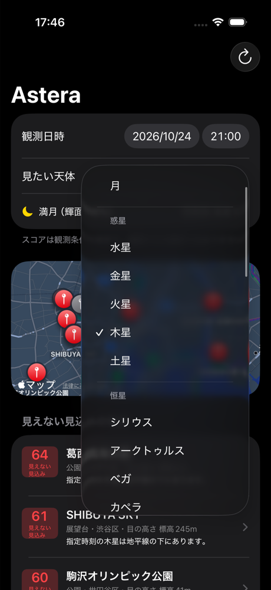

# 惑星と、選べる恒星の追加（3-05）

一覧画面の「見たい天体」で、月・惑星（5 個）・恒星（52 個）を選べる。
惑星の計算は `Packages/StarCore/Sources/StarCore/Astro/Planets.swift`、恒星の一覧は `.../Astro/StarCatalog.swift`。

## 惑星の位置の求め方

出典: Paul Schlyter「Computing planetary positions — a tutorial with worked examples」<https://stjarnhimlen.se/comp/ppcomp.html>

1. 水星・金星・火星・木星・土星と太陽（＝地球の公転）の軌道要素（昇交点黄経 N、軌道傾斜角 i、近日点引数 w、軌道長半径 a、離心率 e、平均近点角 M）を、日数 d の一次式で求める。d は 2000-01-00 0:00（J2000.0 の 1.5 日前）からの日数
2. ケプラー方程式 M = E − e sin E をニュートン法で解き、軌道面の位置 → 太陽中心の黄道座標（黄経・黄緯・距離）にする
3. 木星・土星は、お互いの引力による主要な摂動（黄経で最大約 0.8°）を足す（上の出典の「Perturbations of Jupiter / Saturn」の項）
4. 太陽の地心位置を足して地心の黄道座標にする
5. 黄道傾斜（既存の `Astro.obliquity`）で赤道座標にし、既存の `Astro.horizontal` で地平座標（大気差込み）にする

光行時間・光行差・章動・地心と観測地点の差（視差）は入れていない。どれも 0.01° 前後で、建物の陰に入るかの判定（余裕 δ = 1°）には影響しない。

### 精度

渋谷駅東口（35.658, 139.702816）で、skyfield 1.55（JPL DE421）の見かけの位置（大気差込み）と比べた（`scripts/planet_reference.py`、テストは `PlanetTests`）。テストの許容差は 0.3°。

| 惑星 | 2026-10-24 12:00 UTC | 2026-11-15 09:30 UTC |
|---|---|---|
| 水星 | 0.005° | 0.005° |
| 金星 | 0.008° | 0.009° |
| 火星 | 0.004° | 0.002° |
| 木星 | 0.003° | 0.000° |
| 土星 | 0.012° | 0.006° |

軌道要素は J2000.0 前後で合わせた式なので、何十年も離れると誤差が増える（出典では 1〜2′ 程度）。

### 推薦での扱い

- `ObservationTarget.planet(Planet)` を足し、`Recommender.evaluate` と `RiseSet.times` で `Astro.planet` を呼ぶ
- 月明かりの減点と、薄明（太陽高度 −6° より上は見えない扱い）は恒星と同じ。金星・木星は明るいので本当は薄明でも見えることがあるが、今は恒星と同じに揃えている

## 追加した恒星

出典: Yale Bright Star Catalogue 5th Revised Ed.（Hoffleit & Warren 1991、VizieR V/50）の J2000.0 赤経・赤緯と V 等級。2026-10-24 に VizieR から取得した。
既存の 18 個は変えていない。並びは等級の明るい順（同じ等級は既存の星を先）。

選んだ基準: 東京（北緯 35.7°）で南中高度が 10° 以上（赤緯 > −44.3°）。依頼にあった候補（2 等台前半のよく知られた星を含む）に加え、等級 2.0 より明るいのに入っていなかったメンカリナン・ミルザム・サルガスを足した。カノープス（南中高度 2° 未満）は入れていない。

| HR | 名前 | 赤経 [時] | 赤緯 [°] | 等級 |
|---|---|---|---|---|
| 2618 | アダラ（ε CMa） | 6.9771 | −28.972 | 1.50 |
| 6527 | シャウラ（λ Sco） | 17.5601 | −37.104 | 1.63 |
| 1791 | エルナト（β Tau） | 5.4382 | 28.608 | 1.65 |
| 1903 | アルニラム（ε Ori） | 5.6036 | −1.202 | 1.70 |
| 4905 | アリオト（ε UMa） | 12.9005 | 55.960 | 1.77 |
| 1017 | ミルファク（α Per） | 3.4054 | 49.861 | 1.79 |
| 4301 | ドゥベ（α UMa） | 11.0621 | 61.751 | 1.79 |
| 2693 | ウェズン（δ CMa） | 7.1399 | −26.393 | 1.84 |
| 6879 | カウス・アウストラリス（ε Sgr） | 18.4029 | −34.385 | 1.85 |
| 5191 | アルカイド（η UMa） | 13.7923 | 49.313 | 1.86 |
| 6553 | サルガス（θ Sco） | 17.6220 | −42.998 | 1.87 |
| 2088 | メンカリナン（β Aur） | 5.9921 | 44.947 | 1.90 |
| 2421 | アルヘナ（γ Gem） | 6.6285 | 16.399 | 1.93 |
| 2294 | ミルザム（β CMa） | 6.3783 | −17.956 | 1.98 |
| 3748 | アルファルド（α Hya） | 9.4598 | −8.659 | 1.98 |
| 617 | ハマル（α Ari） | 2.1196 | 23.462 | 2.00 |
| 7121 | ヌンキ（σ Sgr） | 18.9211 | −26.297 | 2.02 |
| 188 | ディフダ（β Cet） | 0.7265 | −17.987 | 2.04 |
| 1948 | アルニタク（ζ Ori A） | 5.6793 | −1.943 | 2.05 |
| 15 | アルフェラッツ（α And） | 0.1398 | 29.091 | 2.06 |
| 337 | ミラク（β And） | 1.1622 | 35.621 | 2.06 |
| 2004 | サイフ（κ Ori） | 5.7959 | −9.670 | 2.06 |
| 6556 | ラサルハゲ（α Oph） | 17.5822 | 12.560 | 2.08 |
| 936 | アルゴル（β Per） | 3.1361 | 40.956 | 2.12 |
| 4534 | デネボラ（β Leo） | 11.8177 | 14.572 | 2.14 |
| 168 | シェダル（α Cas） | 0.6751 | 56.537 | 2.23 |
| 1852 | ミンタカ（δ Ori） | 5.5334 | −0.299 | 2.23 |
| 5793 | アルフェッカ（α CrB） | 15.5781 | 26.715 | 2.23 |
| 603 | アルマク（γ1 And） | 2.0650 | 42.330 | 2.26 |
| 21 | カフ（β Cas） | 0.1530 | 59.150 | 2.27 |
| 5054 | ミザール（ζ UMa） | 13.3987 | 54.925 | 2.27 |
| 8308 | エニフ（ε Peg） | 21.7364 | 9.875 | 2.39 |
| 911 | メンカル（α Cet） | 3.0380 | 4.090 | 2.53 |
| 4057 | アルギエバ（γ1 Leo） | 10.3329 | 19.842 | 2.61 |

- 二重星（アルニタク・アルギエバ・ミザールなど）は BSC の主星の値。肉眼では合わさって少し明るく見える
- アルゴルは変光星（2.1〜3.4 等）。BSC の値（極大）を入れている
- 恒星は J2000.0 の座標のまま計算する（歳差の補正は 3-06）
