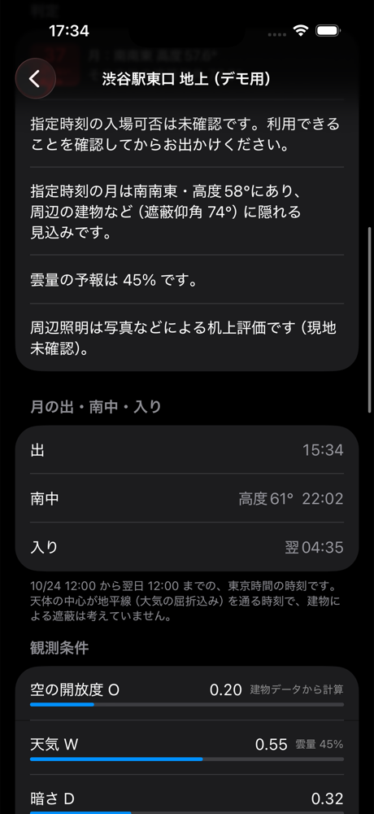

# 天体の出・南中・入り（3-04）

詳細画面の「〇〇の出・南中・入り」に、選んでいる天体のその夜の時刻を出す。
計算は `Packages/StarCore/Sources/StarCore/Astro/RiseSet.swift`、画面は `App/Views/RiseSetSection.swift`。

## 「その夜」の範囲

指定日時を含む **12:00 JST 〜 翌 12:00 JST** の 24 時間。0〜11 時台を指定したときは、前の日の 12:00 から始まる夜として扱う（深夜 1 時に見る月は「前の夜」の月）。

## 探し方

1. 夜の始まりから 10 分ごとに、`Astro.moon` / `Astro.star` で高度を求める（145 点）
2. 高度が 0° 以下 → 0° より上に変わる区間を「出」、逆を「入り」とし、二分法で 1 秒以内に詰める
3. 前後の点より高い点（極大）を「南中」とし、前後 10 分の範囲を三分探索で 1 秒以内に詰める。極大が夜の端（12:00）にしか無いときは南中なし
4. 出も入りも無ければ、最初の点の高度で「沈まない」（ずっと 0° より上）か「この夜は昇らない」（ずっと下）を決める

探し方そのものは天体に依らず、位置を返す関数 `(Date) -> HorizontalCoord` を渡せば使える。夜の中に出（入り）が 2 回あるとき（恒星の出入りが 12:00 近くのとき）は、早い方だけを出す。

### 精度

- 探索の誤差は 1 分よりずっと小さい（放物線のテストで確認）
- 10 分より短い間だけ地平線の上に出る天体は見逃すことがある。東京の緯度で月・明るい恒星にはまず起きない
- 誤差の大部分は位置の式から来る。2026-10-24 の夜・渋谷駅東口で skyfield（JPL DE421）と比べた結果:

| | Astera | skyfield | 差 |
|---|---|---|---|
| 月の出 | 15:34:23 | 15:34:28 | −5 秒 |
| 月の南中（子午線通過） | 22:02:03 | 21:59:47 | +2 分 16 秒 |
| 月の高度が一番高い時刻 | 22:02:03 | 22:02:19 | −16 秒 |
| 月の入り | 翌 04:35:00 | 翌 04:35:32 | −32 秒 |
| シリウスの出 | 23:01:08 | 23:02:27 | −1 分 19 秒 |
| シリウスの南中 | 翌 04:13:31 | 翌 04:14:44 | −1 分 13 秒 |
| 北極星の南中 | 翌 00:00 頃 | 翌 00:37 | 約 −37 分 |

参照値は `python3 scripts/rise_set_reference.py` で出せる。

- 月の南中は「高度が一番高い時刻」で、skyfield の「子午線を通る時刻」とは定義が違う。月は空の上で赤緯（南北の位置）も動くため、この夜は高度の極大が子午線通過より 2 分ほど遅い。skyfield でも高度の極大を探すと 22:02:19 で、差は 16 秒。南中の前後は高度がほとんど変わらないので、画面の使い方ではどちらの定義でも困らない
- 恒星は歳差（地球の首振り）を入れていない（3-06 で直す）。シリウスで 1 分程度、北極星は赤経が 2026 年で約 0.5 時間ずれているため南中が 37 分ほど早く出る。北極星は高度が一晩で 1.5° しか変わらないので、見え方にはほとんど影響しない

## 高度 0° の基準

**大気差込みの、天体の中心の高度が 0°** になる時刻を出入りとしている（`Astro` が返す `HorizontalCoord.altitude` をそのまま使う。地平線付近の大気差は約 0.5°）。

国立天文台の暦計算室などの「月の出・入り」は **月の上端** が地平線に接する時刻で、大気差も 35′ 前後で計算する。月の見かけの半径は約 0.25° なので、こちらの「出」は暦より 1〜2 分遅く、「入り」は 1〜2 分早く出る。恒星は点なので、この違いは無い（大気差の式の違いで数十秒ずれる程度）。

時刻は地平線（高度 0°）の話で、建物による遮蔽は入れていない。実際にその地点から見え始める時刻は、建物の遮蔽仰角ぶん遅くなる。
