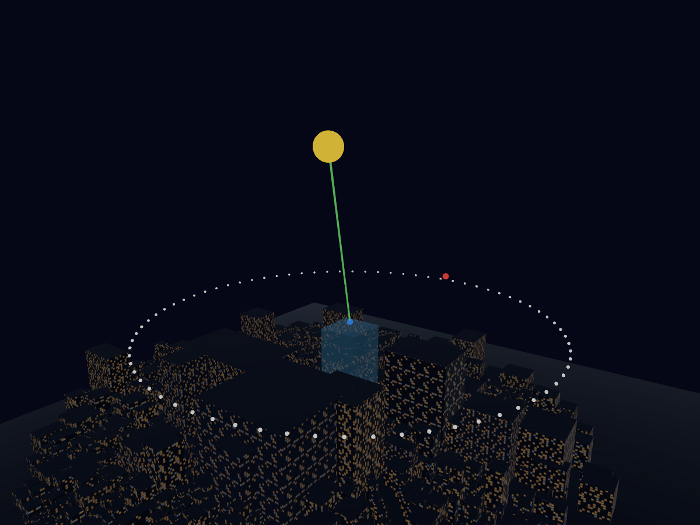

# 8-06 建物の夜景表現

ユーザーが選んだ完成イメージの青灰色の外壁・窓枠・暖色の室内灯を、RealityKitの建物に反映する。実物の外壁写真・現地の点灯状況を再現したものではない。

## 参考の公開実装を調べて修正（2026-10-24）

参考画像1〜3枚目のタイトルから **Slop New York** の公開コードを確認した。以下のリビジョンを参照し、技法をRealityKit向けに別実装した。JavaScriptのコードや写真素材をアプリへ流用していない。

- [tsl-materials.js（12593c9）](https://github.com/mrdoob/slop-newyork/blob/12593c9963f141665fe91881b1b4a2290db51d15/js/tsl-materials.js): `facadeCell` で実寸の窓ベイ・階高と面別座標を扱い、`createCurtainWallMaterial` で窓枠・階の帯・ガラス・室内・凹凸・反射・発光を分けている。
- [buildings.js（同リビジョン）](https://github.com/mrdoob/slop-newyork/blob/12593c9963f141665fe91881b1b4a2290db51d15/js/buildings.js): ガラス、石材、レンガなどの素材と窓幅・階高を使い分けている。
- [Apple: emissiveColor](https://developer.apple.com/documentation/realitykit/physicallybasedmaterial/emissivecolor-swift.property): 発光画像を使う公式例に合わせ、`EmissiveColor(texture:)` で窓の画像だけを渡す。
- [Apple: realistic materials and lighting](https://developer.apple.com/documentation/realitykit/applying-realistic-material-and-lighting-effects-to-entities): 色、法線、粗さのマップを分離する。
- [Apple: ImageBasedLightComponent](https://developer.apple.com/documentation/realitykit/imagebasedlightcomponent): 固定の夜空の環境光を指定し、端末の明るい既定環境に依存しないようにする。

他のX投稿本文は取得できていない。写真が貼られたPLATEAUモデルの参考画像と、シェーダーで窓を作るSlop New Yorkの手法を同じものとして扱わない。今回実装したのは後者の方向である。

## 白い壁になっていた原因

従来は窓用の発光画像と同時に `EmissiveColor(color: .white, texture: ...)` を指定していた。実描画で、一定の発光色が壁全面に加わることを確認した。定数の発光色を外し、黒背景の窓画像だけを渡すと、壁の全面発光が解消した。これは色調や照明を暗くするだけでは直らない問題だった。

## 修正内容

- 業務・オフィスは青灰色のガラス風、商業・ホテルは灰色寄りのベージュ、住宅は落ち着いた灰褐色。用途不明は中立色。
- 色、窓だけの発光、反射の粗さ、窓枠の凹凸の **4マップ** を分離。
- 階ごとの帯、窓枠、窓の奥の陰影、床・天井・一部のブラインドを描く。壁全面を点模様で埋める表現から、窓と壁を分ける表現に変更。
- 窓ベイ3.6m・階高3.9mを実寸のUVに反映。各面の点灯模様を窓ベイ単位でずらす。
- 窓は約24%を暖色中心に点灯。固定IDハッシュでパターンを安定させる。
- ミップマップ・線形補間・異方性フィルターを使う。
- 共通の夜空IBLを生成し、青い環境反射を指定。光源の強さは700/220に抑える。
- 屋根は窓なしのマット素材。ホスト建物は半透明の水色を維持。
- 4種類×4パターンを共有。最大16素材・64枚の256×256テクスチャと1つの環境画像を使い、建物ごとに画像を増やさない。
- 素材生成の失敗時も単色の直方体を表示する。

窓明かりは光害の実測値として扱わず、遮蔽・推薦スコアには影響させない。位置・寸法・建物ID・施設情報は変更していない。道路・看板・屋上設備・実写の壁写真や建物固有の凹凸は対象外。

## 実際の描画結果

下は **アプリと同じ `Sky3DView.buildScene` と `BuildingNightRenderer` をRealityRendererで描画した画像**。生成AIの完成予想画像ではない。SHIBUYA SKY、1,497棟、2026-10-24 21:00 JST、初期カメラの配置を使用した。SwiftUIの文字・枠・操作部は含まないため、アプリ画面のスクリーンショットとは区別する。

[再現用スニペット](verification/render-city.swift)はXcodeの `Sky3DView.swift` の文脈で実行する。メッシュ・材質・月・視線・地平線は既存のシーン構築コードそのものを呼ぶ。Metalの画素形式は `.bgra8Unorm_srgb`、3フレーム描画後にPNGへ保存する。

## 壁面タイル

`BuildingFacade.image(map:)` から出力した実タイル。上からガラス風・石材風・住宅風・その他。凹凸・粗さ・発光の各マップもverification内に保存した。

## 確かめたこと

- **Xcode本体のBuildProjectで修正版のビルド成功**。従来の型チェックだけの確認から更新した。
- Xcodeで実データの素材を生成し、色・発光・法線・粗さの4マップが接続されていることを確認。
- 窓画像に定数の発光色を加えた状態と、画像だけの状態を同じRealityKit描画で比べ、壁全面の発光が消えることを確認。
- 1,497棟の実シーンをGPU描画し、PNGを保存して目視確認。
- 16種の確認用マップを書き出し、消灯部分の発光RGBが黒であることを検証。
- StarCoreのSwift Testing 33件成功。これらはAppの描画コードを対象に含まないため、GPU描画の確認と区別する。
- TextureResourceのiOS 18向け `init(image:options:)` を使い、以前の非推奨APIを置換。

SwiftUIプレビューのスナップショット取得はタイムアウトしたため、今回の画像はXcode上の実行スニペットからのオフスクリーン描画である。実機での全画面表示・回転やズーム操作・長時間の描画速度は引き続き確認が必要。8-06全体の配色・ダークモード整理は継続扱い。
