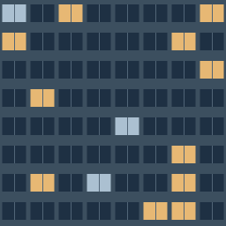
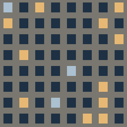
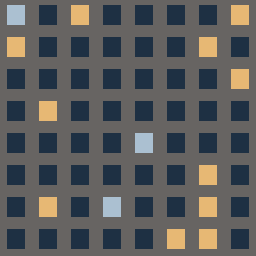
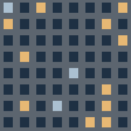

# 8-06 建物の夜景表現

ユーザーが選んだ完成イメージの「青灰色の外壁・細かい窓・控えめな暖色の窓明かり」をRealityKitの建物へ反映する。

## 見た目

- 業務施設・オフィス: 青灰色のガラス風、細い窓枠
- 商業施設・ホテル: グレー寄りのベージュの壁
- 住宅・住居: 落ち着いた灰褐色、小さめの窓
- 用途不明・その他: 中立的な青灰色。用途や実際の壁材を推測でデータに追記しない
- 観測中の建物: 従来と同様、半透明の水色で識別
- 屋根・底面: 暗いマットな素材。窓を描かない
- 窓: 約27%を暖色中心に点灯。一部に淡い白色を混ぜる

これは外観の演出であり、実際の外壁色・素材・照明の現地調査結果ではない。画面に「外壁・窓明かりはイメージ」と表示する。窓明かりは実際の光害の値や遮蔽・推薦スコアに影響させない。実際の空の明るさや月光を再現する照明シミュレーションでもない。

## 実際に使うテクスチャ

下の画像はアプリと同じ `BuildingFacade.image` で出力した壁面タイル。完成イメージの生成画像やシミュレータのスクリーンショットではない。上からガラス風、石材風、住宅風、その他。

## 描画

CoreGraphicsで窓の模様を描き、壁の色と窓だけの発光画像を分けてRealityKitのPhysicallyBasedMaterialに渡す。発光を弱く抑え、地面・照明を青寄りにする。外壁の写真やユーザーの参考画像をそのまま貼り付けていない。

4種類×4パターンの最大16素材（色・発光の最大32テクスチャ）を共有し、建物ごとにGPUテクスチャを作らない。画像は各256×256ピクセル、ミップマップを生成する。固定の建物IDハッシュでパターンを選ぶため、時刻や視点を変えても模様が突然変わらない。

直方体の4側面に実寸から計算したUVを与え、約3.2m間隔の窓・3.4m間隔の階を繰り返す。寸法・位置は元の建物と同じ。屋根・底面には別素材を使う。メッシュやテクスチャの生成が失敗した場合も、単色の直方体を残す。

建物の形・地平線・遮蔽判定・観測者の座標・天体の位置・施設情報は変更しない。道路・看板・屋上設備・現物の外壁写真は今回の対象外。形状は現在の外接直方体のままで、参考の生成画像のような建物固有の凹凸は増やしていない。

## 確認

- 新しい描画コードを含む全AppソースをiOS 18向けに型チェックし成功。StarCoreも同じSDK向けにモジュール生成して参照した。マクロ実行の環境制限を避けるためコンパイラの `-disable-sandbox` を使用。
- `BuildingFacade` を実行して4種の壁・発光画像を生成、寸法、用途別の選択、未確認用途の扱い、固定パターンを確認。
- StarCoreのSwiftテスト33件が成功。
- XcodeGenでプロジェクトを再生成、追加した2ファイルを登録。
- `xcodebuild` はSwift Package解決時の環境制限で失敗。iOSシミュレータでの表示、窓の明るさ、屋根の素材、1,497棟の初期表示速度・スクリーンショットは未確認。ドラフトPRとして提出する。

Swift Testingのテスト対象にはAppの描画コードは含まれない。上の素材確認・型チェックとStarCoreのテスト結果を区別する。TextureResourceの同期生成APIはiOS 18 SDKでは非推奨の警告が出るが、型チェックは成功している。

## 次の確認

iPhone 17 Proシミュレータまたは実機で、地上・屋上の3D、回転・ズーム、時刻変更時に模様が安定すること、ホスト建物の半透明、窓の明るさと起動・表示速度を確認し、実画面をPRへ追加する。8-06全体の配色・ダークモード整理は継続扱いにする。
