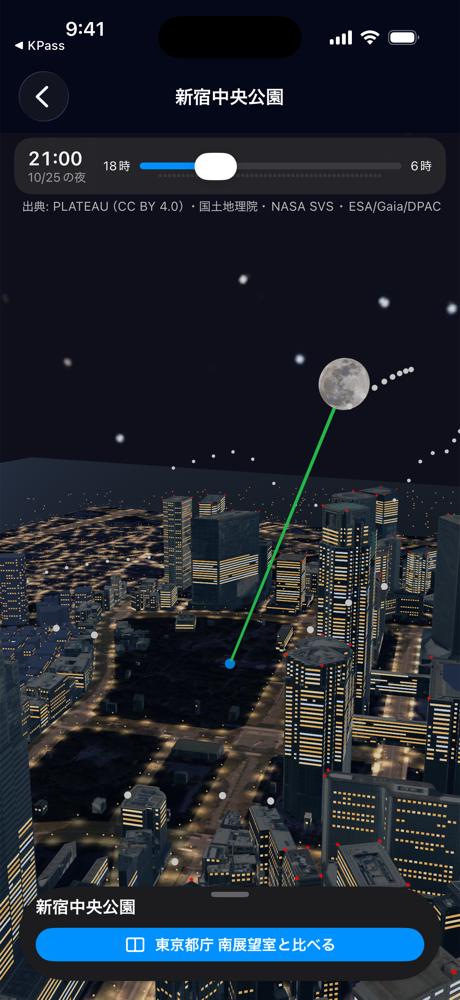
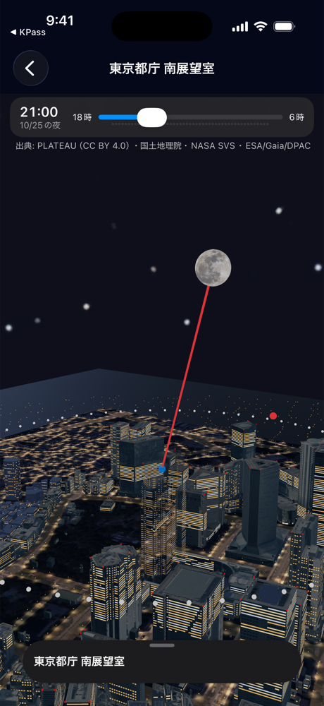
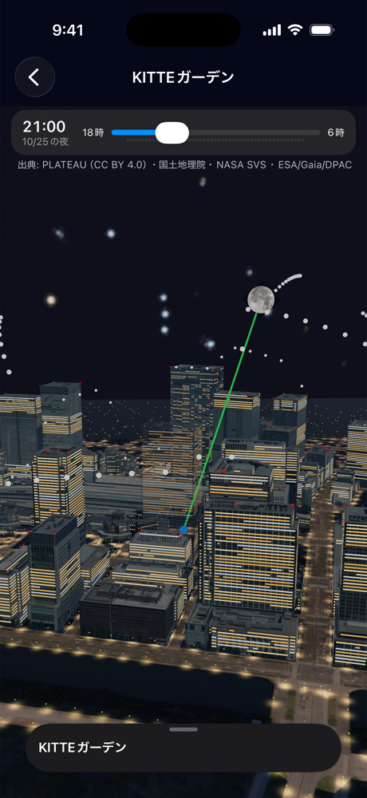

# a・2-05 実写 3D のシーンを量産する

渋谷（4-08）と同じ作り方で、ほかの場所の 3D（PLATEAU の実形状＋実写テクスチャ＋地理院の航空写真＋夜の明かり）を、**設定を1行足してスクリプトを1回動かすだけ**で作れるようにした。**西新宿**（東京都庁 南展望室・新宿中央公園）を作り直し、**丸の内**（KITTE ガーデン）を新しく作った。

| 新宿中央公園（見える） | 東京都庁 南展望室（建物を半透明にして観測者を見せる） |
|---|---|
|  |  |

| KITTE ガーデン（JP タワーを半透明に。左奥が東京駅） |
|---|
|  |

2026-10-25 21:00 の月。iPhone 17 Pro シミュレータ。

## 新しいシーンの足し方

1. [docs/data/city-scenes.json](../../data/city-scenes.json) に1行足す（ID・名前・原点の緯度経度・建物の半径・地面の写真の半径・アトラスの枚数・作業フォルダ）
2. 地点（`spots.json`）の `sceneId` をそのシーンの ID にする。展望台など建物の中・上に立つ地点は `hostBuildingId` に PLATEAU の gml:id を入れる
3. 次を実行する（取得済みのファイルは取り直さない。1シーン 10〜20 分ほど。Blender 4.0.2 で確認）

```bash
python3 scripts/build_city_scene.py <シーンID>
xcodegen generate   # City_<ID>.usdz を足したとき
```

手順は `catalog → download → boxes → shapes → textures → photo → roads → model → install`。`--steps boxes` のように一部だけも動かせる。

| 手順 | すること | 書き出すもの |
|---|---|---|
| catalog | PLATEAU の公式カタログ API に範囲で問い合わせ、建物（半径 500m）と道路（800m）にかかる 3次メッシュの GML を選ぶ | `docs/data/plateau-<ID>-2025.json`（目録） |
| download | GML とコードリストを取る。目録に大きさと SHA-256 を書き足す（2回目からは一致を確かめる） | 作業フォルダ |
| boxes | 判定用の箱（外接直方体）を作り、`buildings.json` の**そのシーンだけ**を差し替える | `buildings.json`、`docs/data/<ID>-scene-integration.json` |
| shapes〜model | 渋谷と同じ（[4-08](../plateau-3d/README.md)） | 作業フォルダの USDZ |
| install | アプリの資産に写す | `App/Resources/City/City_<ID>.usdz` |

アプリのコードは直さなくてよい。`CityModelRenderer` が `City_<シーンID>.usdz` をファイル名で見つけ、無ければ今までどおり箱で描く。

## 決めたこと

- **区をまたいでも1つ**: 東京都の 2025 年度データは、同じメッシュ番号なら区が違っても同じファイル（ETag で確認）なので、メッシュごとに1つだけ取る
- **基準標高**: 原点から 200m 以内の建物の地盤標高（PLATEAU の底面）の中央値を 1m 単位で使う。西新宿は 36m（手作りデータの 40m から変わった）。屋根がこれより低い建物（坂の下の 33 棟）は、平坦と見なすと空をふさがないので入れず、件数を記録する
- **屋内の展望室**: 観測者が建物の中にいる（目の高さ < 建物の屋根）とき、その建物だけ別の部品にして**半透明**で描く。部品名の最後に `_h` ＋ gml:id の英数字 8 文字を付け、アプリが同じ規則で探す
- **容量と GPU メモリ**: 新しいシーンは実写のアトラスを 1 枚（4096px 四方。GPU 上で約 90MB）にした。渋谷は 2 枚。別のシーンを開くと、前のシーンの元データは手放す

## 西新宿で変わったこと

- 建物: 手作りの 8 棟 → PLATEAU の **791 棟**（LOD2 441 棟、LOD1 350 棟。用途・名前つき）
- 東京都庁 南展望室の `hostBuildingId`: `tocho_1` → `bldg_94caaf2f-dec2-41a7-8b0f-06ecd0fac6c7`（PLATEAU の gml:name が「東京都庁第一本庁舎」。地盤 34.6m・屋根 260.6m）
- 判定（地平線）の変化（2026-10-24 時点の `develop` との比較。目の高さ・地点の位置は変えていない）

| 地点 | 空の開放度 O | 一番高い遮蔽 | 南東（135°） |
|---|---|---|---|
| 新宿中央公園 | 0.859 → **0.641** | 65.4° → 59.4° | 31.0° → 28.5° |
| 東京都庁 南展望室 | 0.995 → 1.000 | 3.6° → 0° | 0° → 0° |

- 中央公園は周りの建物が増えたぶん空が狭くなった。都庁は自分の建物を除くと、より高い建物が周りに無い
- 周辺の用途（6-05）が西新宿でも出るようになった

## 丸の内で変わったこと

- KITTE ガーデンに `sceneId: "marunouchi"` を入れた。いままで建物データが無く、地平線を一律 25°（暫定）としていたのを、PLATEAU の **350 棟**（LOD2 341 棟。メッシュ 53394610/11/20/21、千代田区の配布から取得）で計算するようになった。基準標高 3m
- PLATEAU では KITTE の低層部と JP タワーが1棟（`bldg_f0028aa3-…`、名前「JPタワー」、高さ 201m）なので、`hostBuildingId` を JP タワーにした。3D では JP タワーを半透明にして、屋上庭園の観測者を見せる。地平線の計算では、観測者が箱の中にいるので JP タワーは前から数えていない（入れても入れなくても同じ）。そのため**JP タワーの高層部が実際にふさぐ方角は判定に入っていない**（2-08 と同じく箱の近似の限界）
- 判定の変化: 空の開放度 0.577（一律 25°）→ **0.431**、一番高い遮蔽 66.7°、南東（135°）58.7°。丸の内の高層ビルに囲まれているぶん、空が狭くなった

## 容量

| ファイル | 大きさ |
|---|---|
| `City_shibuya.usdz`（既存） | 27.8 MB |
| `City_shinjuku.usdz`（今回） | **14.4 MB**（三角形 15.3 万、アトラス 1 枚・縮小率 0.248） |
| `City_marunouchi.usdz`（今回） | **17.1 MB**（アトラス 1 枚） |
| `buildings.json` | 0.42 MB → 0.76 MB |

## 出典・ライセンス

- 建物の形・外壁と屋上の写真・道路: 東京都「3D都市モデル（Project PLATEAU）新宿区（2025年度）」 https://www.geospatial.jp/ckan/dataset/plateau-13104-shinjuku-ku-2025 を加工して作成（CC BY 4.0）。取得したファイルと SHA-256 は [plateau-shinjuku-2025.json](../../data/plateau-shinjuku-2025.json)
- 丸の内: 東京都「3D都市モデル（Project PLATEAU）千代田区（2025年度）」 https://www.geospatial.jp/ckan/dataset/plateau-13101-chiyoda-ku-2025 を加工して作成（CC BY 4.0）。[plateau-marunouchi-2025.json](../../data/plateau-marunouchi-2025.json)
- 地面の写真: 国土地理院「地理院タイル（全国最新写真（シームレス））」 https://maps.gsi.go.jp/development/ichiran.html を加工して作成
- 写真の無い屋上・壁、写真の外側の地面: ambientCG「Concrete034」「Asphalt031」（CC0）

3D の凡例に「出典: PLATEAU（CC BY 4.0）・国土地理院」が出る（渋谷と同じ）。

## 確かめていないこと

- 実機での描画速度・メモリ（シミュレータでは渋谷と同じく、開いた直後は暗く、触ると出る）
- KITTE ガーデンの床の高さ（36m）と、屋上庭園の上で観測者を置いた位置（地点の緯度経度のまま）
- 都庁展望室の床の高さ（`floorElevation` 242m は手作りの地面 40m から決めた暫定値のまま。PLATEAU の地盤なら約 236.6m。1-07 で決める）
- 3D の向き・建物の位置が実物と合っているか（4-04）
