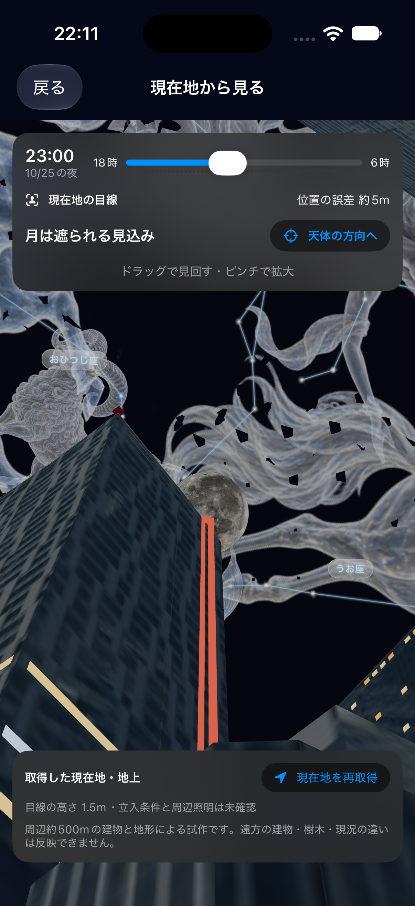
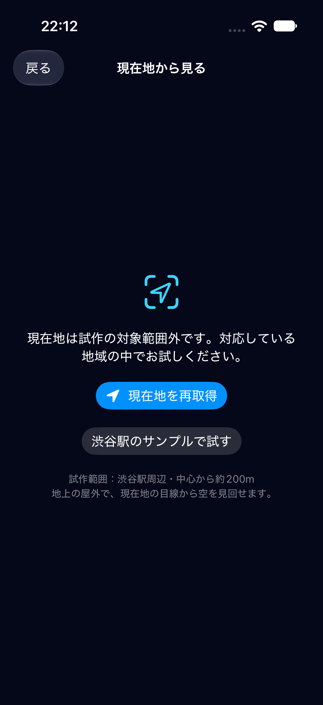

# b-3 渋谷駅周辺の現在地から観測する

## できること

天体の確認画面またはホームの「現在地から見る」から、現在地の目線で周囲の3Dと空を見回せる。
天体の確認画面から直接入る場合、23区全体の3Dを読み込まない。
新しい2D地図画面や、判定の後に3Dへ切り替える段階表示は追加しない。
ドラッグで見回し、ピンチで拡大し、「天体の方向へ」で選択した天体へ向ける。
日時を変えたときは同じ街と地平線を使い、天体位置を更新する。

## 対象範囲とデータ

- 渋谷シーンの原点（35.6580, 139.7016）から半径200m以内、地上・屋外。目線は地面から1.5m。
- 建物は同梱済みの渋谷シーン（周囲500m、1,497棟、PLATEAU由来）と既存の実形状3Dを再利用する。
- 地面は国土地理院DEM1A（PNG、ズーム17）から20m格子へ加工し、位置ごとに補間する。
- 地形はDEM10B（PNG、ズーム14）から50m格子へ加工し、現在地から方位1°・距離100m刻みで周囲3kmの遮蔽を計算する。
- 追加する地域データは `observation-regions.json`、108,912バイト。建物や画像を重複して同梱しない。
- 初回を含め、現在地の3D表示・標高・遮蔽計算にデータ取得の通信は不要。位置取得はOSに依存する。
- 天体選択で星座を選んだ場合の判定対象は、既存と同じ代表星。

標高の出典：[国土地理院の標高タイル仕様](https://maps.gsi.go.jp/development/demtile.html)、
[配信URL・利用条件](https://maps.gsi.go.jp/development/ichiran.html#dem)。
原本25タイルのURL・SHA-256と取得日を地域JSONの `sourceTiles`・`generatedAt` に記録する。
アプリ内の出典は設定の「出典とライセンス」にまとめている。

再生成（Python 3、Pillowが必要）：

```bash
python3 scripts/build_observation_region.py \
  --scene shibuya --name 渋谷駅周辺 \
  --sample-latitude 35.658 --sample-longitude 139.702816 \
  --cache /private/tmp/astera-observation-dem \
  --output Packages/StarCore/Sources/StarCore/Resources/observation-regions.json
```

## 位置情報と未確認の扱い

- ユーザーが押したときだけ、高精度の現在地を1回取得する。歩きながらの連続追跡はしない。
- 誤差25m超、取得から60秒超、不正な座標は使わず、再取得を案内する。
- 許可拒否・取得失敗・20秒の取得待ち超過・対象範囲外を明示する。
- 地上の目線が判定用の建物内に入る座標は拒否する。勝手に建物を消したり、近くの登録地点へ移したりしない。
- 表示する位置は座標確定時のスナップショット。「現在地を再取得」で取り直す。アプリに戻ったときは再取得を案内する。
- サンプルはユーザーが「渋谷駅のサンプルで試す」を選んだ場合だけ表示し、現在地と明確に区別する。
- 施設情報・照明・光害・見える方角は既存地点からコピーせず未確認にする。施設の推薦スコアは表示しない。
- 「方向が開けている見込み」は建物・地形の幾何学的な判定。実際の天候や見える確率を保証する表示ではない。

## 精度の限界

周囲500mより外の建物、樹木、工事、柵、現在の立入条件は未確認。
地面は格子の補間であり、実形状3Dの地面は既存の平面のままなので、坂では足元の描画にずれが残る。
GPSの許容誤差内でも、壁の近くでは実際の立ち位置と判定が違う可能性がある。
地域を拡張する前に、建物の収録範囲と表示・判定の一致、実機の速度を検証する必要がある。

## 確認

- StarCore：座標・鮮度・精度、範囲外、建物内、標高の補間と欠損、観測位置移動による遮蔽の変化、実データのサンプルをテストする。
- シミュレータの位置設定例：`xcrun simctl location <UDID> set 35.658,139.702816`。
- 計算を止める・再取得する際は、古い計算結果を新しい現在地として表示しない。
- 現地での見え方・GPSの実機精度は未確認。

2026-10-25 の確認結果：

- `swift test --scratch-path /private/tmp/astera-b3-default`：217件成功。既存ビルドフォルダのFinderメタデータによる署名エラーは、新しい一時フォルダで回避した。native方式でも217件成功。
- Pythonの標高PNG変換・座標方向・欠損値のテスト：3件成功。
- `xcodebuild -scheme StarSpot -destination 'platform=iOS Simulator,name=iPhone 17 Pro' -derivedDataPath /private/tmp/astera-b3-derived CODE_SIGNING_ALLOWED=NO build`：成功。
- iPhone 17 Pro / iOS 27.0 の専用シミュレータで、天体の確認画面から現在地の目線へ直接入ること、位置誤差表示、範囲外での再取得案内、ユーザーが選んだ場合だけサンプルへ移ることを確認した。
- 実機でのGPS誤差・描画速度・メモリ使用量と、手でのドラッグ・ピンチ操作は未確認。

| 現在地の目線 | 対象範囲外 |
|---|---|
|  |  |
