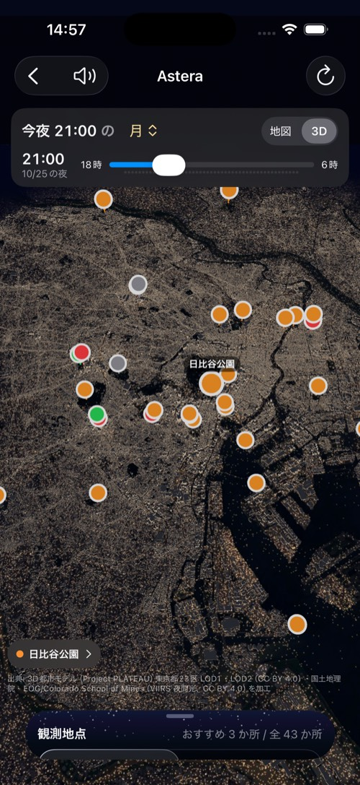
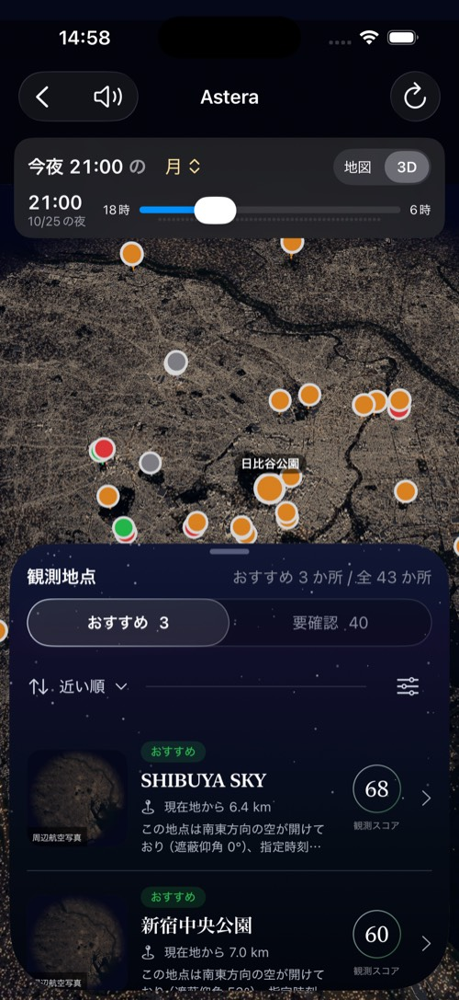
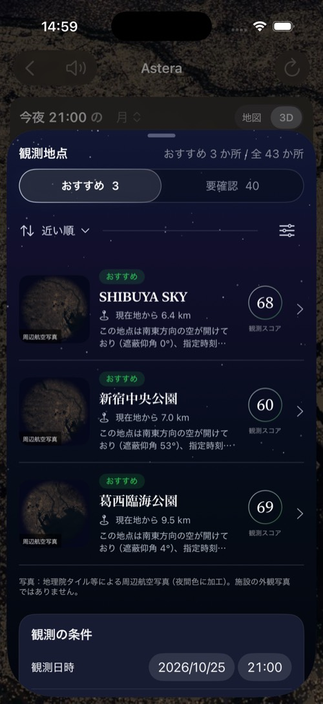
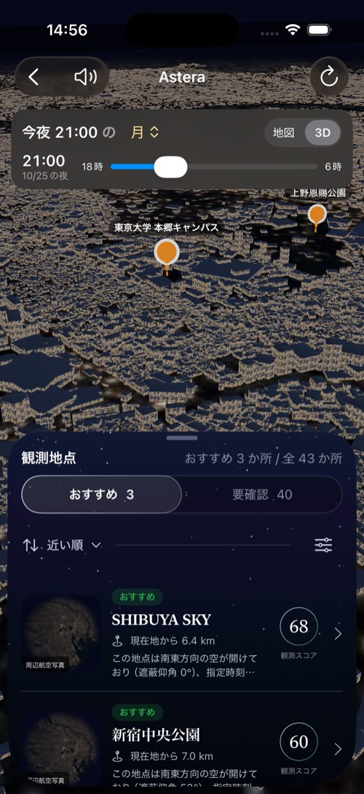
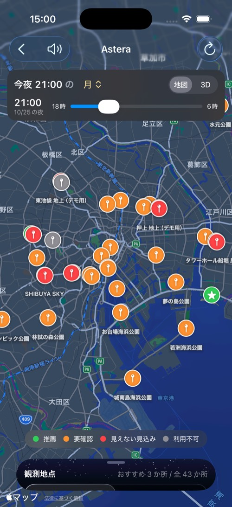
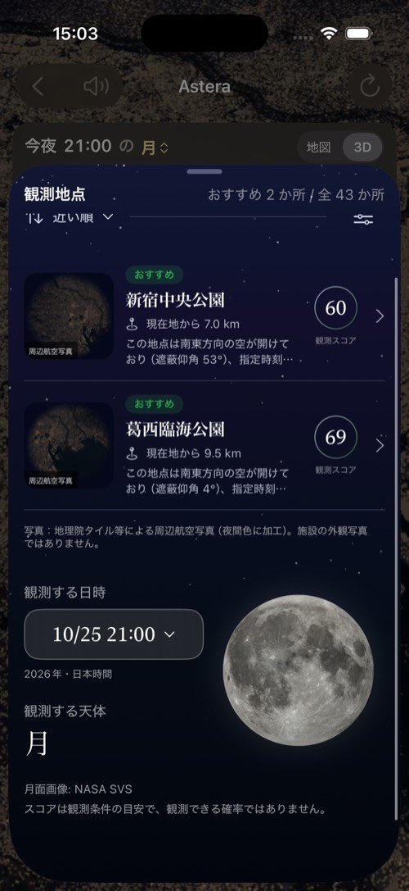

# ホームの全画面 3D ＋シート（8-10）

ホームを、地点の詳細（8-09）と同じ「全画面の 3D ＋下から引き上げるシート」にした。シミュレータ iPhone 17 Pro（2026-10-25）で撮影。

| 画面 | 内容 |
|---|---|
|  | たたんだ状態。23 区の 3D を背景いっぱいに出し、上に日時・天体・「地図／3D」、下にシートの見出し。俯瞰では、画面中央に一番近い地点（日比谷公園）だけに地点名を出す |
|  | 近づくと、画面に入っているピン全部に地点名を出す（しきい値は `WideCityLabels.showAllDistance`） |
|  | 半分。一覧を見ながら、裏の 3D・時刻スライダーも触れる |
|  | 全開。裏の 3D を外し、静止画に置き換えて軽くする |
|  | 一覧の行を押すと、ホームのシートを閉じてから詳細へ進む（詳細のシートとぶつからない） |
|  | 詳細から戻ると、ホームのシートと 3D の向きが元に戻る |
|  | 「地図」に切り替えると、背景が 2D の地図になる（シートは同じ） |
|  | シートのいちばん下に、8-15 の日時・天体のカード（題字なし） |
