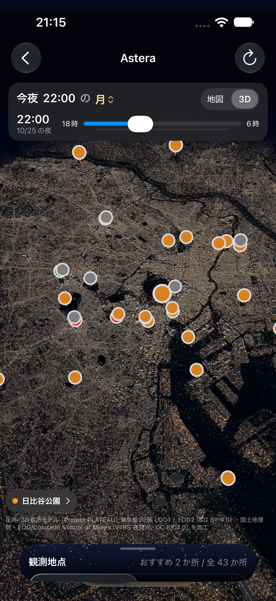
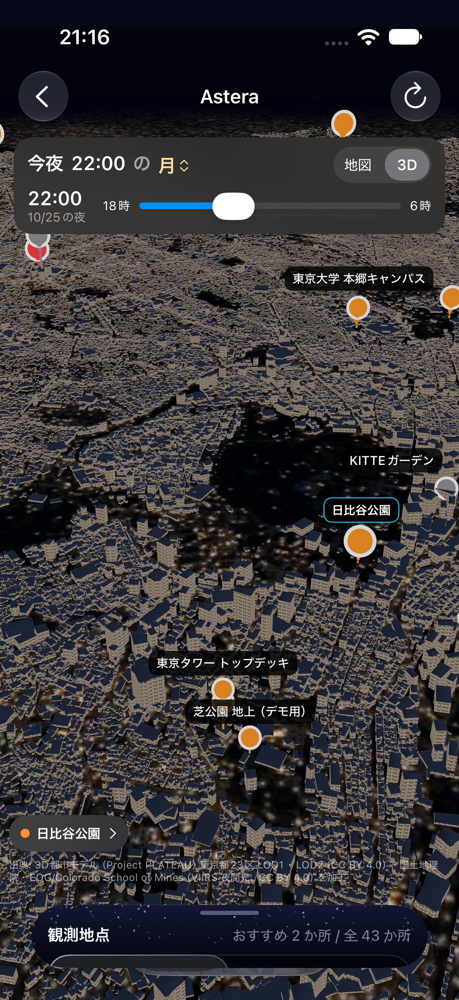
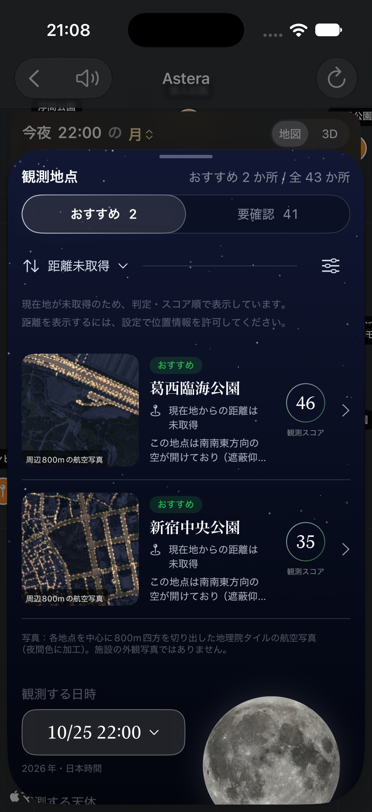
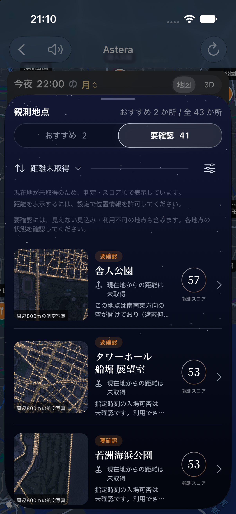

# 8-17 Homeの地点名と一覧画像

## 変更内容

- 3D地図の全体表示では地点名を隠し、カメラ距離120以下（1単位=100m）に拡大すると近くの名前を表示する。
- 遠景の地点名と重なる名前は間引く。文字を遠くへ移動したり長い引き出し線を引いたりせず、画面端・上部カード・下のシートを避ける。
- 2D地図はMapKit標準のマーカーで、縮尺と混み具合に応じて名前を自動調整する。押すと既存の詳細画面へ進む。
- おすすめ／要確認の一覧画像を92ptから132ptへ拡大。幅350pt未満や大きな文字では、画像とスコアの下に説明を表示する。
- 約40km四方の広域画像から、観測地点を中心に800m四方を切り出した専用画像（512px）へ変更。
- 43地点すべてを収録。共通の3Dシーンを使う地点も、それぞれの緯度経度を中心に切り出す。
- 専用画像がない場合は「写真なし」と表示する。新しい地点を足したら下のスクリプトを再実行する。

## 航空写真の出典と再生成

元画像は `App/Resources/City/City_<sceneId>.usdz` に同梱済みの `textures/ground_photo.jpg`。
国土地理院「地理院タイル（全国最新写真（シームレス））」を夜間色に加工し、道路の光を加えた既存の3D用画像を再利用する。
施設外観や実際の夜景の写真として扱わない。新しい外部データの取得や生成画像による置き換えは行っていない。

```bash
swift scripts/make_spot_thumbnails.swift
xcodegen generate
```

macOSとXcodeの `usdcat` が必要。元画像の地面の四隅をUSDから読み取り、`CityScene.localPosition` と同じ換算で地点を画像上へ投影する。
出力先は `App/Resources/SpotThumbnails/spot_<spotId>.jpg`。合計約4.5MB。アプリでの表示時に通信は行わない。

## 検証

- `swift test`: 185テスト、32スイート成功。
- iPhone 17 Pro向け `xcodebuild ... build`: 成功。
- iPhone 17 Pro（iOS 27.0）のシミュレータで、3Dの全体表示／拡大表示、おすすめ／要確認の画像拡大を確認。
- 確認用アプリのみHomeへ直接入る初期状態・カメラ距離・一覧の初期タブを一時変更し、確認後に元へ戻した。
- 一覧の確認画像は設定タブ追加前に取得。同じ一覧の実装を使っている。設定タブ追加後の構成でも最終ビルド成功。
- 2DはMapKit標準マーカーへ変更し、縮尺・重なりの処理を標準地図に任せる。
- 実機・小さい画面・大きな文字・ピンから詳細への遷移の再確認は未実施。

## 確認画像





