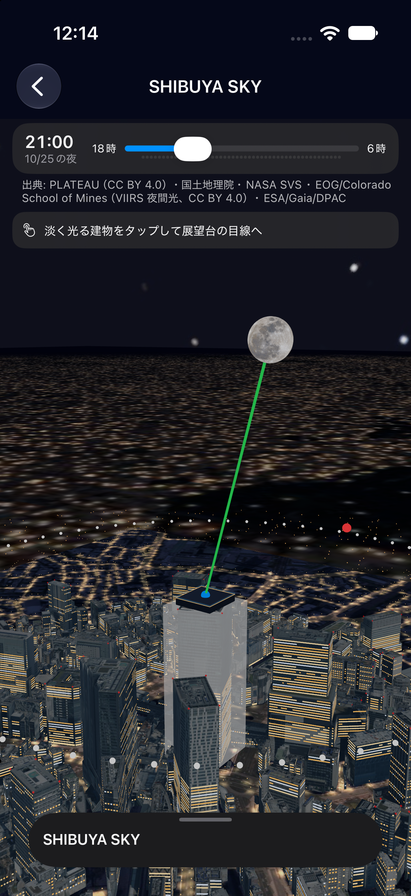
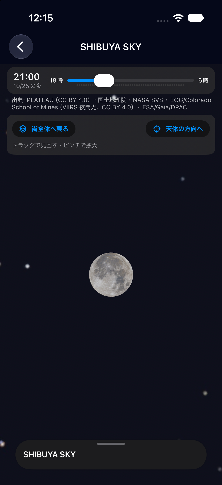

# b-1-1・b-1-2 建物から観測者視点へ入る

2026-10-25。渋谷の地上・SHIBUYA SKY が対象。

## 使い方

1. SHIBUYA SKY の詳細、または比較画面を開く。
2. 白くふわっと明滅する建物をタップする。地上では青い観測位置のマークをタップする。
3. 約2.8秒で観測位置へ近づき、選択中の天体の方向を見上げる。
4. ドラッグで見回し、ピンチで視野角を変える。「天体の方向へ」で向きを戻せる。
5. 「街全体へ戻る」で、入る前の街の向き・距離に戻る。移動中は「戻る」で中断できる。

白い明滅は約1秒の周期（明るくなる0.5秒＋薄くなる0.5秒）。建物の写真が残る薄さで、実際の建物の形に重ねる。「視差効果を減らす」が有効な場合は明滅と移動演出を省く。

## 確認結果

- StarCore：130テスト・28スイート成功。開始・終了位置、近づいてから見上げる順序、途中の連続性、方向ベクトルの安定性を確認。
- iPhone 17 Pro シミュレータ：ビルド成功。建物へのタップ、移動完了、街全体へ戻る操作を確認。白い明滅と、移動中に全体表示の目印が画面を覆わないことを録画で確認。
- iPhone 16：個人用の開発署名でビルド・更新インストール。ユーザーが建物をタップして観測者視点まで移動できたことを確認。白い明滅への変更版も導入済み。
- 最新developの広域LOD2データ追加を取り込んだ状態で、上記の計算テストとシミュレータビルドを再確認。

実機での白い明滅の見た目、長時間の速度・メモリ、現地の眺望との一致は未確認。遮蔽判定と実形状の差（4-13）は残る。星座・端末の向き・カメラARは b-1-3〜b-1-5、全地点への展開は b-2。

## シミュレータの画面と動画

| 白い強調表示 | 観測者視点 |
|---|---|
|  |  |

[建物へ近づいて空を見上げる動画（9秒）](entry.mp4)。この動画は明滅を約1秒周期に速める前の記録。
