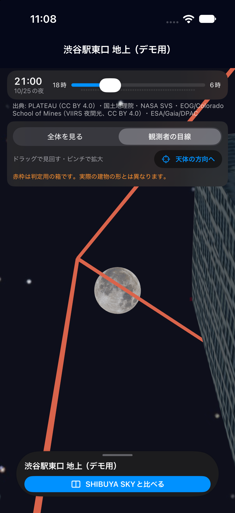
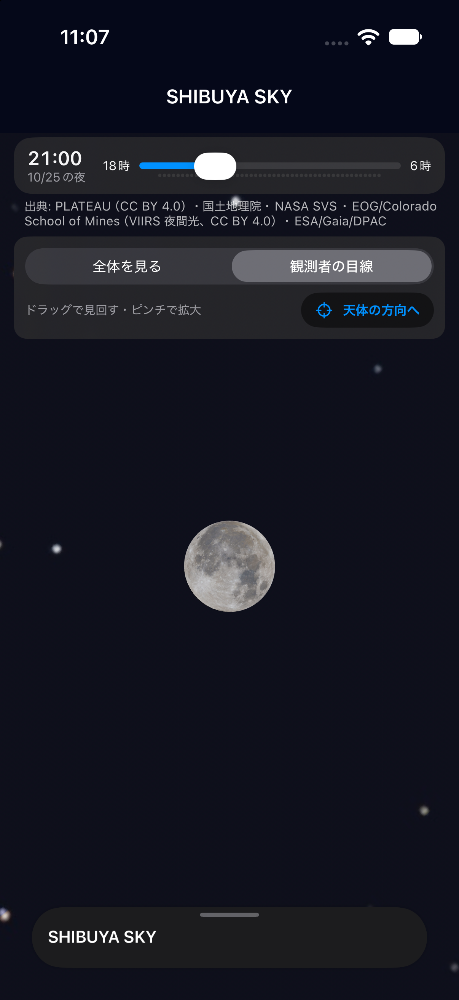
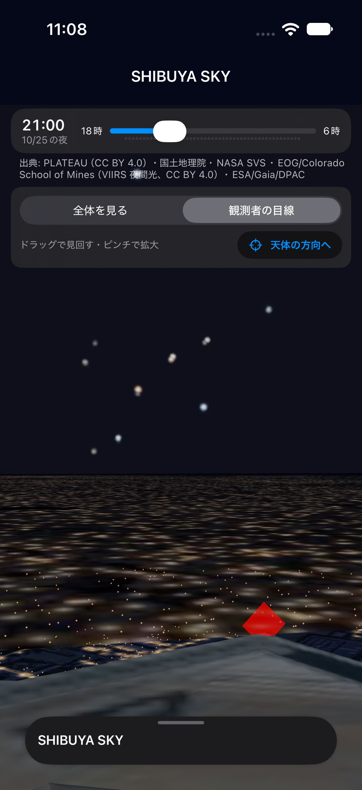
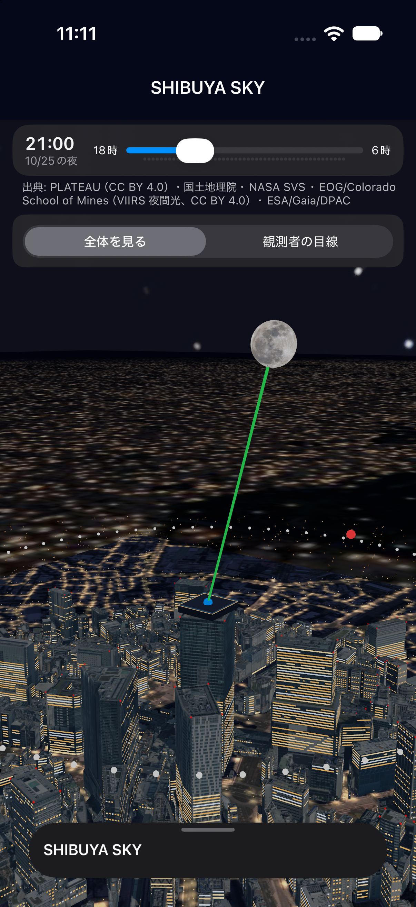
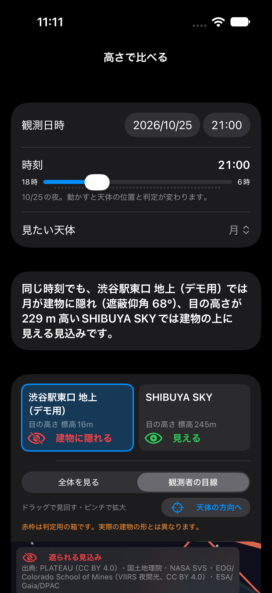
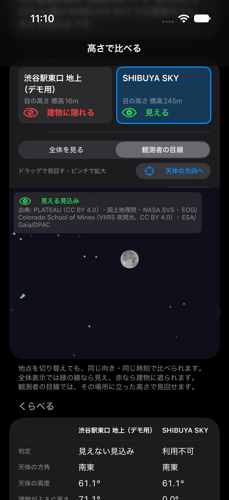
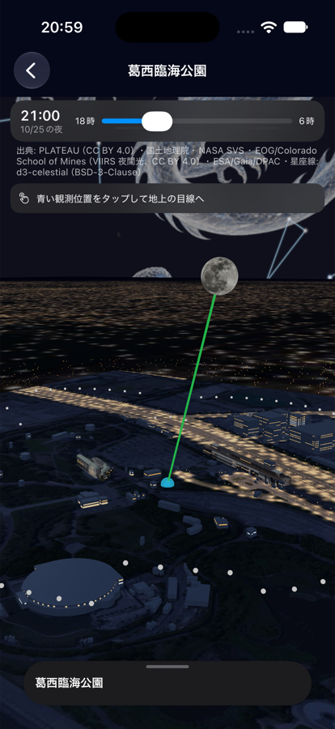
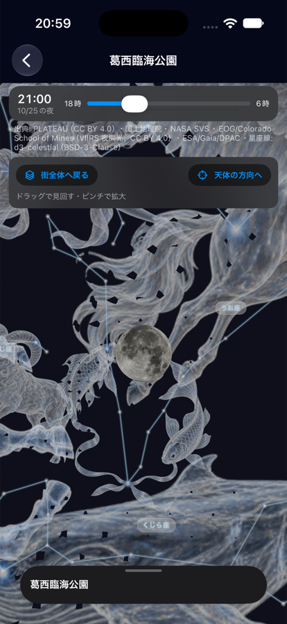

# b-1 渋谷の観測者視点

このページは初回試作の記録。建物タップ・白い明滅・ズーム演出と実機操作の最新結果は [b-1-1・b-1-2 の記録](../observer-entry/README.md) を参照。

対象は渋谷駅東口 地上（デモ用）と SHIBUYA SKY。ほかの地点への展開は b-2。

## 使い方

1. 渋谷の地点の詳細、または地上・展望台の比較画面を開く。
2. 「観測者の目線」を選ぶと、その地点の目の高さから選択中の天体の方向を見る。
3. ドラッグで左右・上下に見回す。ピンチは視野角だけを変え、観測者の位置と高さは動かさない。
4. 「天体の方向へ」で、選択中の時刻の天体の方向へ戻る。
5. 「全体を見る」で、切り替える前の全体表示の向きと距離に戻る。

比較画面では地点を切り替えても向き・視野角を保つ。時刻を変えると天体と窓明かりが更新され、見回していた向きは保つ。

## 表示の扱い

- 3D の原点は観測者の目。地面・建物を「床の標高＋目の高さ」だけ下げ、カメラを原点に固定する。近くの物は 5cm 先から描く。
- 見回しは北をまたげる。上下は ±85°、視野角は 25〜80°。真上・真下で向きが反転することを避ける。
- 目線表示では青い観測者、地平線の点、北の球、視線の線、全体表示用の仮の展望デッキ・柵を隠す。現地の窓・柵の再現ではない。
- 判定用の赤枠は残す。遮蔽判定は従来どおり建物を直方体で近似し、実写の 3D 形状そのものとは別。
- **2026-10-25 21:00 の地上では、計算は「隠れる」だが、実形状の 3D では月が見える差を確認した。** 赤枠と画面の説明で近似を明示する。この差の解消は 4-13。月を判定に合わせて強制的に消す処理は入れていない。
- 月は従来と同じく見やすさのため実際より約 12 倍大きく表示する。目線表示では街より遠くに置き、角のある背景が空を隠さないよう円形の面で描く。
- 見回しだけでは月の画像や窓明かりを作り直さない。日時・対象天体・視点の種類が変わったときだけ更新する。

## 確認結果（2026-10-25）

- `swift test --scratch-path /private/tmp/astera-b-1-swift-build`：125 テスト・27 スイート成功。
- `xcodebuild -scheme StarSpot -destination 'platform=iOS Simulator,name=iPhone 17 Pro' build`：成功。生成物は一時フォルダへ分離。
- 新しいテストでは東西南北、北をまたぐ見回し、上下・拡大の限界、拡大しても向きが変わらないこと、古い JSON の互換性を確認した。
- 2026-10-24 21:00 の計算では地上の目の標高 16.5m、SHIBUYA SKY の 245.5m で判定が変わることを確認した。
- iPhone 17 Pro シミュレータで、地上・展望台の目線、見回した方向、全体表示、比較画面を撮影した。
- 比較画面は一時的な検証用入口から、全体→目線、地上→展望台、21:00→21:30 と状態を順番に変え、再描画を確認した。指でボタンを押した確認ではない。

この環境には操作用の Simulator.app がないため、スクリーンショットは実際の詳細・比較画面を直接表示する一時的な確認用入口で撮影した。画面の中身は本番と共通で、確認用入口は納品コードから削除した。

実機への導入も確認した。b-1 の機能コミット `f1f21c8` を個人の開発用署名でビルドし、接続中の iPhone 16（iOS 27.0）の既存 Astera に更新インストールした。起動コマンドの成功と、実機のホーム画面の表示を確認済み。個人用のチーム・アプリ識別子はビルド時に指定し、共有プロジェクトの設定は変更していない。実機の画像には現在地からの距離が含まれるため、リポジトリへは追加していない。

**未確認**：指によるドラッグ・ピンチ・ボタン操作、実機の 3D の動作・速度・メモリ、現地の眺望との一致。9-04 は実機の 3D 操作を確認するまで進行中とする。位置・床面標高など元データの暫定値も引き継いでいる。

## スクリーンショット

2026-10-25 21:00（比較画面の状態変更後のみ 21:30）。天気の値や利用可否を実地確認した画像ではない。

| 地上の目線（判定用の赤枠） | 展望台から月の方向 |
|---|---|
|  |  |

| 展望台で見回した方向 | 全体表示 |
|---|---|
|  |  |

| 比較画面の地上 | 視点・地点・時刻を変更した比較画面 |
|---|---|
|  |  |

## b-2 への引き継ぎ

`CityScene.observerViewEnabled` を省略したシーンは従来の全体表示のみ。渋谷でだけ `true` にしている。量産時は各地点の座標・高さ・建物の内外・判定と実形状の差を確認し、確認済みのシーンのデータにこの設定を足す。地点 ID によるコード上の特別扱いは追加していない。

## b-2-1 全地点への展開

2026-10-25。`buildings.json` の全 32 シーンに `observerViewEnabled: true` を付け、全 43 地点で目線へ入れるようにした。展望台・屋上は淡く光る建物、公園・広場など建物の無い地点は青い観測位置をタップして入る。コードの地点ごとの特別扱いは足していない。合わない地点が見つかったら、そのシーンの印を外せば全体表示だけに戻る。

- `scripts/build_city_scene.py` でシーンを作り直しても、この印は前のシーンから引き継ぐ。
- テストで、全 43 地点のシーンに印があり、展望台・屋上の建物がシーンにあることを確かめる。
- iPhone 17 Pro シミュレータで、渋谷以外の 1 か所（葛西臨海公園、2026-10-25 21:00 の月）で、案内「青い観測位置をタップして地上の目線へ」→ 青い印をタップ → 目線（月・星座）→「街全体へ戻る」を確かめた。展望台の光る建物（都庁など）からの入口、ほかの地点の位置・高さ・眺めの一致、実機は未確認（b-1 と同じく、元データの暫定値を引き継ぐ）。
- 目線の空に、黒い小さな四角い影がいくつか見えた。今回の変更（印を付けただけ）とは別の表示の問題と思われるが、原因は未確認。

| 葛西臨海公園の全体表示 | 葛西臨海公園の目線 |
|---|---|
|  |  |
