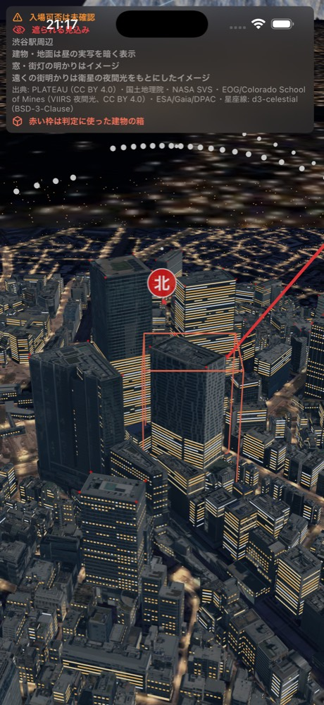
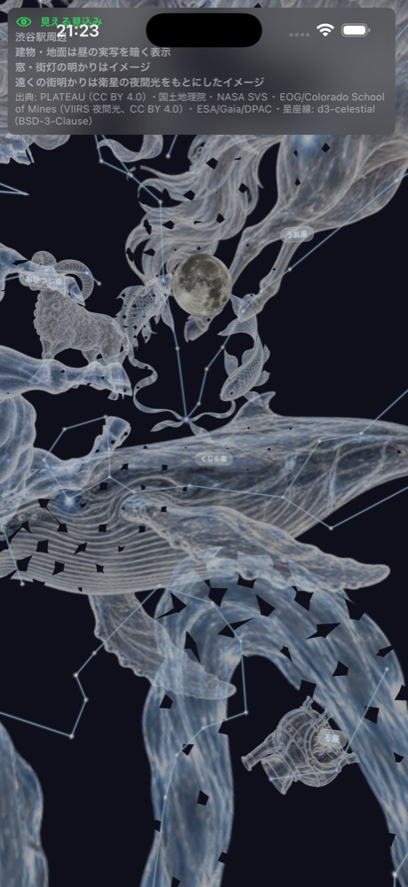
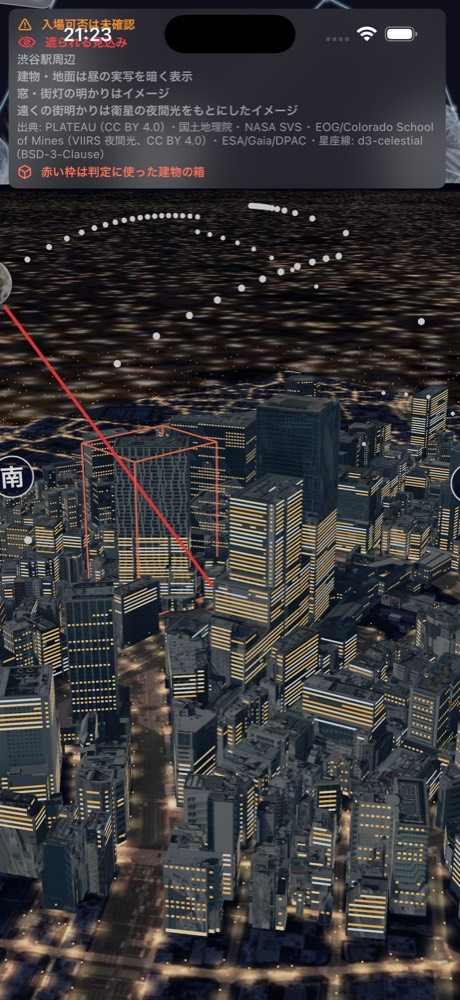
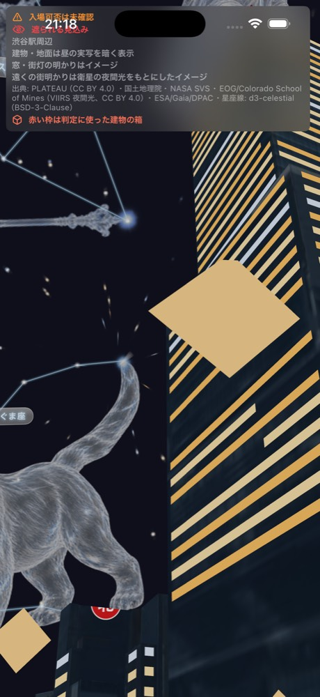
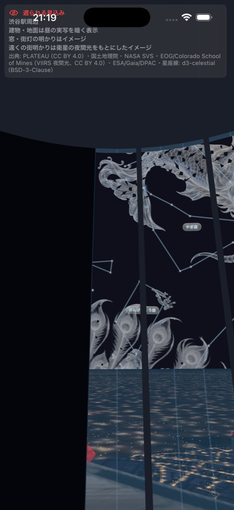
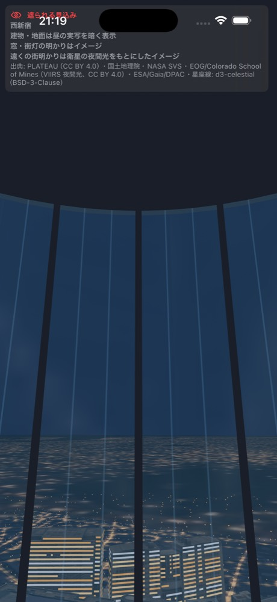

# 3D の向きの確認（4-04）

詳細画面の 3D で、北の向き・建物の位置・月の方角が実物と合っているかを確かめた記録。2026-10-25 にミスミ（AI エージェント）が確認。

## 結論

- **ずれは見つからなかった**。3D の北（赤い点・4-05 で足した「北」の文字）と建物の並びは、地図データ（OpenStreetMap）と方位 4° 以内で一致する
- 2026-10-25 21:00 の月の方位・高度は、アプリと skyfield の差が方位 0.24°（空の上の距離で 0.13°）、高度 0.01°
- 確かめていないこと: Apple マップとの目での見比べ（地図アプリの代わりに OpenStreetMap の建物の座標を使った）、国立天文台 暦計算室との比較（skyfield で代用。過去の検証 [verification.md](../astro/verification.md) で skyfield との差は 1° 以内と確認済み）、現地の写真との比較

## (a) 北の向きと建物の並び

3D の座標は x が東、y が上、-z が北（`SkyRenderer.vector`、`Sky3DView+Scene.swift` の建物の置き方）。建物の位置は `buildings.json` の `x`（東）・`y`（北）[m] で、地点の位置は `CityScene.localPosition` で同じ座標に直している。この 2 つから求めた方位を、OpenStreetMap（Nominatim で検索した建物の中心）と比べた。

| 建物（渋谷駅東口 地上 から） | アプリの方位・距離 | OpenStreetMap の方位・距離 | 差 |
|---|---:|---:|---:|
| 渋谷スクランブルスクエア | 310°（北西）・67 m | 308°・69 m | 2° |
| 渋谷ヒカリエ | 33°（北東）・143 m | 31°・152 m | 2° |
| 渋谷ストリーム | 160°（南南東）・93 m | 164°・92 m | 4° |

| 建物（SHIBUYA SKY から） | アプリ | OpenStreetMap | 差 |
|---|---:|---:|---:|
| 渋谷ヒカリエ | 59° | 56° | 3° |
| 渋谷ストリーム | 147° | 149° | 2° |

- 参照: Nominatim の結果（2026-10-25 取得）。スクランブルスクエア 35.6583792, 139.7022161（way 617560918）、ヒカリエ 35.6591803, 139.7036853（way 204091879）、ストリーム 35.6572033, 139.7030976（way 521438304）
- 差の数度は、アプリの建物が PLATEAU の外接矩形の中心で、OSM の中心と少し違うため。判定の余裕（δ = 1°）とは別の、建物の中心の取り方の差で、向きが回っているわけではない（3 棟とも差の向きがそろっていない）
- 3D の見た目でも、カメラを南から北へ向けると、「北」の文字の左手前（北西）にスクランブルスクエアの高い塔が見える

## (b) 2026-10-25 21:00（日本時間）の月

| 地点 | アプリ（`Astro.moon`） | skyfield 1.55 + DE421 | 差 |
|---|---|---|---|
| 渋谷駅東口 地上（標高 16.5 m） | 方位 127.62°・高度 56.63° | 方位 127.38°・高度 56.64° | 方位 0.24°・高度 0.01° |
| SHIBUYA SKY（標高 245.6 m） | 方位 127.62°・高度 56.63° | 方位 127.38°・高度 56.64° | 方位 0.24°・高度 0.01° |

- skyfield は大気差あり（気温 10°C・気圧 1013 hPa）。[verification.md](../astro/verification.md) と同じ条件
- 3D では、月は方位 127.6°（南東）に置かれる。目線（SHIBUYA SKY）で方位 128°・高度 40° を向くと、画面の中央の真上（高度 56°）に月が見える

## 方位の文字（4-05）の見え方

目線のモードでは、文字は遠くの地平線の上に置き、見上げても画面の下のほうに残るよう、視線の高さに合わせて少し上げる。建物の向こうでも読めるよう、奥行きを見ずに描く。

## 屋内展望室の窓・屋根（4-06）の見え方

- 窓の範囲（`viewingDirectionMask`）の外は暗い壁、窓は薄いガラス、窓の上端の高度（`maxVisibleAltitude`）の上に屋根を置く。観測者の周り半径 3 m の演出で、建物の形とは別
- 今の `spots.json` には `viewingDirectionMask` が入った地点がまだ無い（1-08 で作業中）。下の 1 枚目は、確かめるためだけに SHIBUYA SKY を「屋内・窓は方位 200°〜330°・上端 40°」に一時的に書き換えて撮った（コミットしていない）
- 2 枚目は都庁南展望室（窓の範囲は未設定なので全方位ガラス、上端 35° の屋根）。新宿のシーンはまだ目線のモードに入れないので、`observerViewEnabled` を一時的に true にして撮った

## 気づいたこと（直すのは別タスク）

- 渋谷駅東口 地上では、この時刻の月は判定では隠れる（月の方位の遮蔽仰角 67.5° > 高度 56.6°）。これは向きのずれではなく、判定の箱と実形状の差の問題で、4-13 で扱っている
- 渋谷以外の地点はまだ目線のモードに入れない。カレッタ汐留で一時的に入れてみると、灰色の面に囲まれて外が見えなかった（建物の中に目が入っているように見える。b-2「全地点を SHIBUYA SKY 相当にする」で扱っている）
