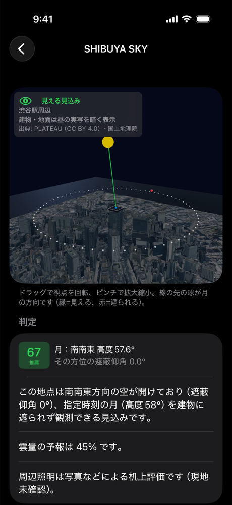
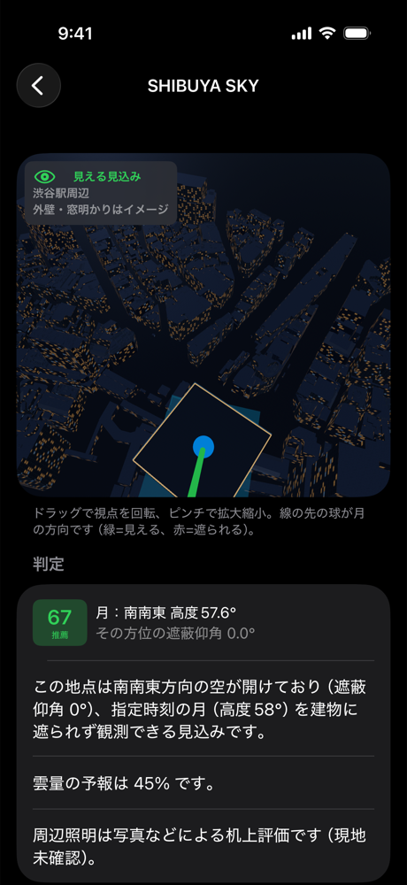
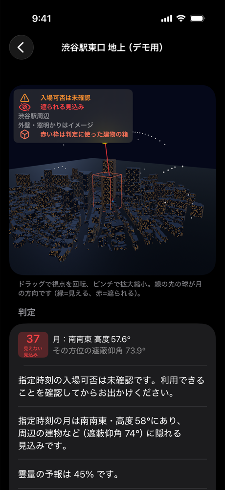
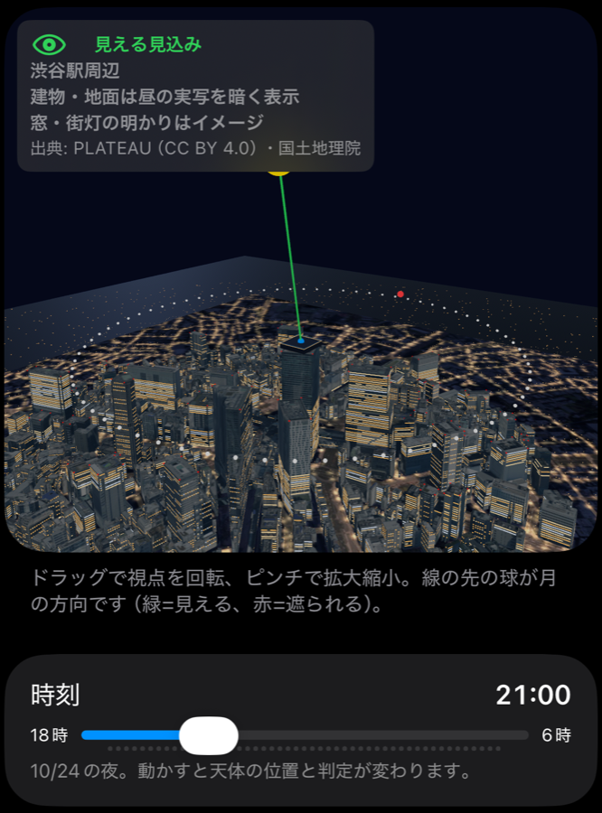
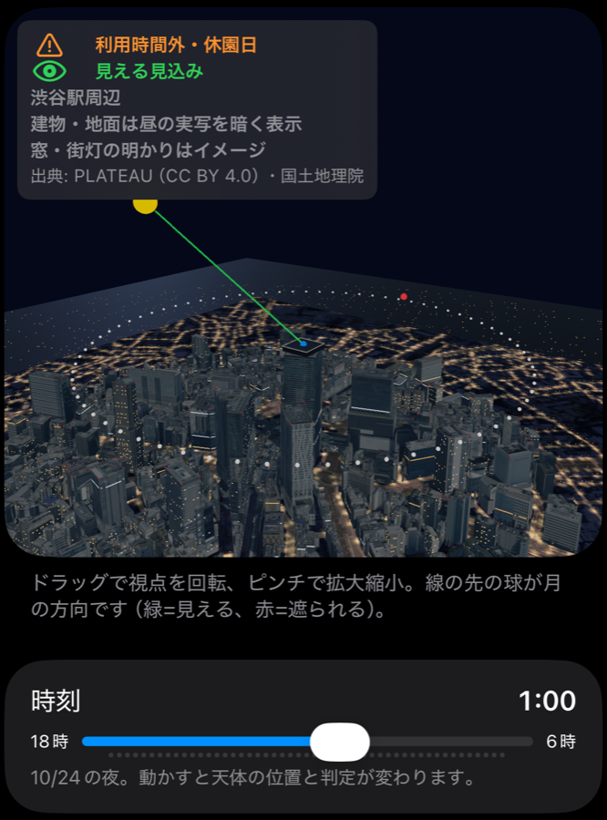
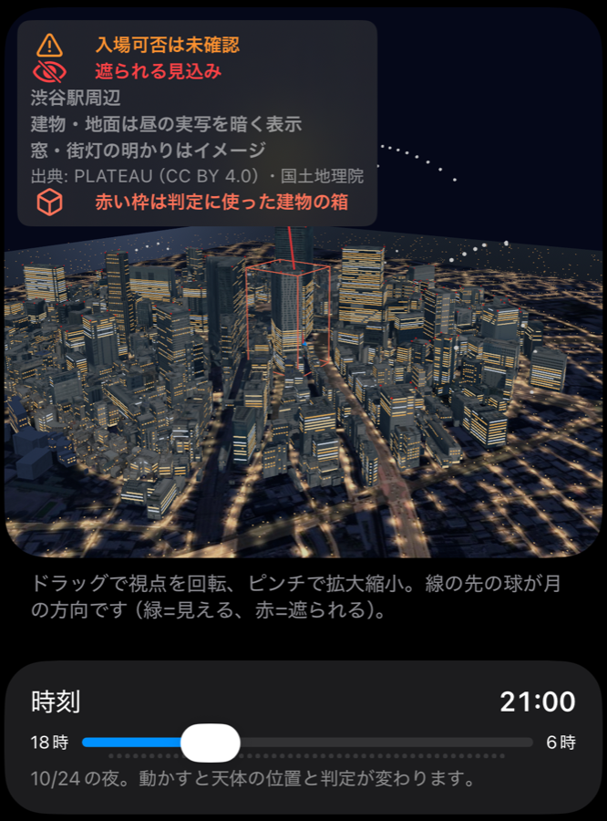

# 4-08 PLATEAU の実形状・実写テクスチャで 3D を描く

渋谷の 3D を、外接直方体（建物をすっぽり包む箱）＋作り物の窓模様から、**PLATEAU の LOD2（屋根・壁の形まであるデータ）の実際の形と、航空写真から作られた実写の外壁・屋上**に替えた。地面には国土地理院の航空写真を貼った。**見た目だけの変更**で、位置・寸法・地平線・遮蔽判定・スコアは今までどおり `buildings.json` の箱で計算する（4-13 で、遮蔽判定は同じ LOD2 から作った部分の箱に変えた）。

| SHIBUYA SKY（見える） | 展望デッキから見下ろす | 渋谷駅東口 地上（隠れる） |
|---|---|---|
|  |  |  |

2026-10-24 21:00 の月。iPhone 17 Pro シミュレータで撮影（4-08 の時点。4-09 で下の夜の明かりを足した）。

## 4-09 夜の明かり

| SHIBUYA SKY 21:00 | SHIBUYA SKY 1:00（窓が減る） | 渋谷駅東口 地上 21:00 |
|---|---|---|
|  |  |  |

- **窓明かり**: 壁ごとに、階（3.6m）と窓の間隔（3.2m）で窓を並べ、建物 ID・階・列から決まる乱数で点ける（毎回同じ模様）。事務所は階ごとに帯で点き、住宅は窓ごとにばらばらに点く。1 階の店先は横長の帯。位置はイメージで、実物の窓とは合わない
- **時刻で減る**: 窓を消える順に 3 グループに分け、時刻スライダーの時刻で切り替える（17 時に点き、事務所は 22 時、次は 23 時半、住宅などは翌 5 時に消える。`NightLightSchedule`）
- **道路と街灯**: PLATEAU の道路（tran、LOD1）の縁に沿って 25m おきに街灯（高さ 6m の光の点）を 4,779 本並べ、路面と街灯の下の明るさを地面の写真に焼き込んだ（夜の暗さも焼き込み済みで、アプリは照明に関係なくそのまま表示する）
- **航空障害灯**: 高さ 60m 以上の建物の屋上の角に赤い光を 128 個置き、ゆっくり点滅させる
- **遠くの街**: 地面の写真の外（約 1.45km まで）に、道路のような列の光を散らした。形は作り物
- 凡例に「窓・街灯の明かりはイメージ」と出す。判定・スコアは変えていない（地上は「遮られる」、SHIBUYA SKY は「見える」のまま）

## 何が変わったか

- 1,497 棟を実形状で描く（LOD2 が 1,434 棟、LOD2 が無い 63 棟は LOD1 の柱状）。屋上の段差・塔屋・設備も入る
- 面の約 9 割（61,427 面）に PLATEAU の実写テクスチャを貼る。写真は昼のものなので、**夜は暗く青みに寄せて表示**する（凡例に「建物・地面は昼の実写を暗く表示」と出す）。写真の無い面は CC0 のコンクリート
- 地面は地理院タイルの航空写真（約 1.6km 四方）。その外側は CC0 のアスファルト
- 月が建物に隠れるとき、**h(A) を決めている建物の判定用の箱を赤い枠**で示す。実際の形は箱より細いので、枠が無いと「線が建物の脇を抜けて見えるのに判定は遮られる」ことが起こりうるため
- 観測者の床が建物の屋根より高い地点（SHIBUYA SKY）に、屋上の展望デッキ（足元灯・ガラスの柵）を出す。形はイメージで、計算には使わない
- 1,497 個あった建物の部品を 20 個ほどにまとめたので、描画の回数が減る（実機では未計測）
- 8-06 の窓明かりの素材（`BuildingNightRenderer`）は、3D ファイルが無いシーン（西新宿など）でそのまま使う

## 作り方

```bash
O=../outputs/plateau-shibuya-2025
# 1. 原本の GML を取得（約360MB、リポジトリの外に置く）
python3 scripts/download_plateau.py --output $O

# 2. LOD2 の面と、実写テクスチャの貼り方を取り出す（buildings.json の 1,497 棟だけ。箱の高さで切りそろえる）
python3 scripts/plateau_shapes.py $O/*_bldg_6697_op.gml \
  --buildings Packages/StarCore/Sources/StarCore/Resources/buildings.json \
  --scene-id shibuya --output $O/shibuya-shapes.json

# 3. 使う実写テクスチャ（4,066 枚、約60MB）を取得
python3 scripts/download_plateau_textures.py $O/shibuya-shapes.json --output $O

# 4. 地面の航空写真（地理院タイル z18、14×14 枚）を取得
python3 scripts/download_gsi_photo.py --latitude 35.658 --longitude 139.7016 --radius 800 --output ../outputs/gsi-shibuya

# 5. 道路の面を取り出す（地面の写真の範囲だけ。1 の取得に道路の GML も入っている）
python3 scripts/plateau_roads.py $O/*_tran_6697_op.gml \
  --buildings Packages/StarCore/Sources/StarCore/Resources/buildings.json \
  --scene-id shibuya --ground ../outputs/gsi-shibuya/ground.json --output $O/shibuya-roads.json

# 6. Blender（4.0.2 で確認）で USDZ にする。作業用の画像は出力先の atlas-work/ にできるので、
#    出力はリポジトリの外に置き、できた USDZ だけを App/Resources/City/ に写す
/Applications/Blender.app/Contents/MacOS/Blender -b --python scripts/blender_city_usdz.py -- \
  $O/shibuya-shapes.json $O/night/City_shibuya.usdz ../outputs/gsi-shibuya $O/shibuya-roads.json
cp $O/night/City_shibuya.usdz App/Resources/City/
```

- 2 の `plateau_shapes.py` が、窓明かりと航空障害灯の位置も一緒に書き出す（`scripts/night_lights.py`）

- 実写テクスチャは合計 3.4 億画素あり、そのままでは実機の GPU メモリに入らない。Blender で 28% に縮め、4096px 四方の画像（アトラス）2 枚にまとめた（GPU 上ではミップマップ込みで 1 枚約 90MB）
- 部品の名前（`atlas_0`・`atlas_1`・`ground_night`・`roof`・`facade_*`・`windows_<グループ>_<色>`・`lamps`・`far_lights`・`aviation`）で、アプリが夜の調子の材質を付ける
- 3D ファイルは 29MB（4-08 の 22MB から、窓 4.2 万枚・街灯・遠くの光のぶん増えた）。明かりの部品は UV を書き出さずに小さくしている
- 座標は x=東・y=北・z=シーンの地面からの高さ [m]。RealityKit は Z 上向きの USD を Y 上向きに直して読むことを確かめた
- 坂の上の建物が浮かないよう、壁の下端はシーンの地面（15m）まで伸ばす（箱と同じ扱い）。地面の写真は 0.3m 下に置く
- 中庭などの穴（内側の輪）は扱わず、屋根は埋まる
- ほかのシーンも、`City_<シーンID>.usdz` を足せばコードを直さずに実形状になる。無ければ今までどおり箱で描く。作り方は [city-scenes](../city-scenes/README.md) の `scripts/build_city_scene.py` にまとめた

## 判定の箱との違い（2-08 に記録）

LOD2 の最も高い点は、判定の箱（`measuredHeight` と LOD1 から作った高さ）より **中央値 2.2m、最大 24m 高い**（屋上の塔屋・設備などが箱に入っていない）。1,260 棟で箱を超える部分があった。今回は見た目と判定が食い違わないよう、**3D の形を箱の高さで切りそろえた**。箱の高さを LOD2 に合わせるかは判定が変わるので、2-08 で別に決める。

**4-13・2-08（2026-10-25）**: 判定は外接直方体ではなく、LOD2 から作った部分の箱（`scripts/plateau_blocks.py`）で行うようにした。部分の箱も同じ高さで切りそろえるので、判定と 3D が一致する（渋谷駅東口 地上で中央値 0.2°）。塔屋・設備は今は入れない。[記録](../../geometry/4-13-judgement-vs-3d.md)

## 出典・ライセンス

- 建物の形・外壁と屋上の写真: 東京都「3D都市モデル（Project PLATEAU）渋谷区（2025年度）」 https://www.geospatial.jp/ckan/dataset/plateau-13113-shibuya-ku-2025 を加工して作成。CC BY 4.0
- 地面の写真: 国土地理院「地理院タイル（全国最新写真（シームレス））」 https://maps.gsi.go.jp/development/ichiran.html を加工して作成
- 写真の無い屋上・壁: ambientCG「Concrete034」 https://ambientcg.com/a/Concrete034 （CC0）
- 道路の形（街灯の位置・路面の明るさ）: 同じ PLATEAU 渋谷区（2025年度）の道路（tran）を加工して作成。CC BY 4.0
- 写真の外側の地面: ambientCG「Asphalt031」 https://ambientcg.com/a/Asphalt031 （CC0）

地理院タイルは出典の明示が利用の条件なので、3D の凡例に「出典: PLATEAU（CC BY 4.0）・国土地理院」と出す。

## 確かめていないこと

- 実機での描画速度・メモリ・アプリの大きさ（3D ファイルは 29MB。シミュレータでは 3D が出るまで 1〜2 秒）
- 窓・街灯の数や明るさが実際の渋谷の夜景に近いか（参考画像に寄せて目で調整しただけ）
- 航空障害灯の点滅の速さ・色は実物の決まりに合わせていない
- 3D の向きが実物と合っているか（4-04）。写真と形・地面の写真は、見た目ではずれていない
- 西新宿・丸の内も同じ手順で作った（[a・2-05](../city-scenes/README.md)）
