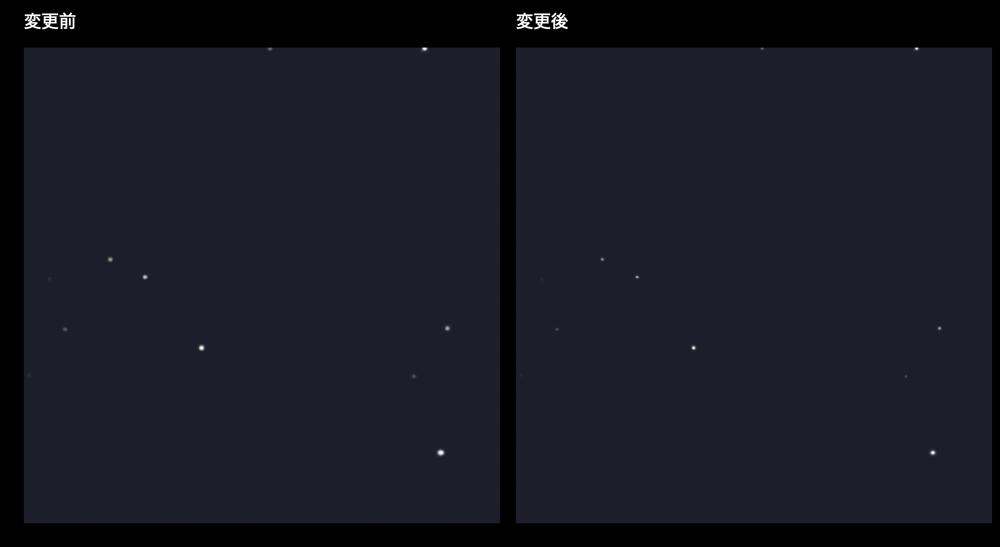

# 星図の星を鮮明にする（b-1-3-1・k）

星の輝きを半径 3px・σ1.3 で広げていた加工を、半径 2px・σ0.75 に縮小。JPEG 保存を PNG に替え、細い輪郭に出ていた圧縮のにじみを抑えた。星図は同じ NASA 4K 原本から作り直した。

見本は都心の星図の一部を同じ範囲で切り出したもの。左が変更前、右が変更後。

画像の大きさはどちらも 4096×2048。PNG 化で画像容量は都心 250KB→406KB、郊外 512KB→1.0MB、暗い場所 3.1MB→13MB。表示時の展開サイズは同じ。等級別の星数（都心 1,275、郊外 5,490）は維持した。地上画面で星が引き伸ばされる問題（b-1-3-2）は別タスク。

確認: 星図の同位置を拡大して輪郭が締まったこと、アプリのシミュレータ向けビルド成功を確認。
