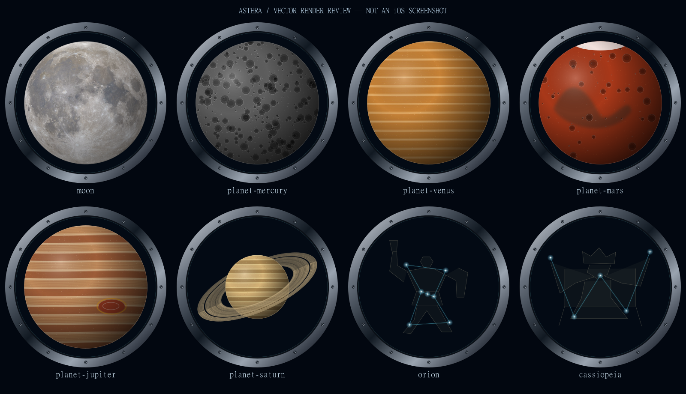

# 8-11・8-12 宇宙船の丸窓から天体を選択

起動時にRealityKitの宇宙を表示し、左右スライドで対象を丸窓の中央に合わせる。中央対象を押すと、同じ丸窓の確認画面へ進む。「確定」でAppModel.targetを更新し、既存の観測場所一覧へ進む。「戻る」では観測対象を変更せず、中央の対象とスクロール位置を保持する。

## 8-12の変更

- 外枠と宇宙が見える開口部を正円に統一。開口径は外径の87%。角度による金属の反射、内側の黒い厚み、細い青色の縁、12本の留め具を重ねた。
- 窓には対象の姿だけを入れ、名前・操作は窓の外へ移動。小さい画面と横向きでは縦スクロールで確認・戻るボタンへ到達できる。
- 選択画面と確認画面は同じCabinPortraitとCabinWindowFrameを使う。
- 月・5惑星・52恒星・2星座の全60対象を共通の1000単位の正方形に描画。透明画像の余白ではなく、円盤・環の外周・星と星座絵の座標の全体から大きさを決める。
- 星座は絵と星を含む全頂点の外接範囲から中心を求め、最遠点を半径430に合わせる。光のにじみ23を足しても開口半径500より内側に収まる。
- 月面は既存のNASA SVS画像を再利用。水星はクレーター、金星は雲、火星は地形と極冠、木星は縞と大赤斑、土星は縞と前後関係のある環を描き分ける。
- 恒星は青白色・暖色の発光と粒状の表面。星座は明るい星・線・薄い人物画。背景の3D星は360個から120個に減らし、表示を控えめにした。
- Canvasの図形は表示解像度に合わせて描画される。月以外の表面と星座絵は選択用の模式イラストで、実写やその日時の姿ではない。
- 新しいAppソースや画像参照は追加せず、既存2ファイル内で実装する。月の画像はすでに同梱されているmoon_disk.pngを使用。

## 描画プレビュー

これはSwiftUIの描画と同じ図形・座標・乱数式をSVGとして描いた確認用画像。iOSシミュレータのスクリーンショットではない。SVGとSwiftUIの描画処理・光のにじみには差がある。

## 確かめたこと

| 対象 | 可視部分の最大半径（開口半径500） | 確認 |
|---|---:|---|
| 月・水星・金星・火星・木星 | 435 | 円盤全体が収まる |
| 土星 | 455.75 | 環の外周と線幅を含め収まる |
| 全52恒星 | 490 | コロナまで収まる |
| オリオン座・カシオペヤ座 | 453以下 | 絵・線・星の光まで収まる |

全60対象の寸法チェックは成功。さらに月・5惑星・縦長のオリオン座・横長のカシオペヤ座を静止画で確認した。開口径に対する主要輪郭の占有率は約86〜91%、恒星の光の外周は98%。円の縁に対して正の余白を残す。

## iOSでの検証待ち

Windows環境にSwift・Xcode・iOSシミュレータがないため、ビルド・swift test・指操作・実際の描画速度は未確認。これらが完了するまでtask.mdは進行中とする。

- `swift test --package-path Packages/StarCore`
- `xcodebuild -scheme StarSpot -destination 'platform=iOS Simulator,name=iPhone 17 Pro' build`
- 左右スライド・矢印→中央タップ→確認→戻るで元の位置へ復帰。
- 確定時だけ観測対象が変わり、地図・推薦一覧へ進む。
- 選択画面・確認画面の両方で、月・土星・他の惑星・縦長と横長の星座に欠けがない。
- 小画面・横向き・大きな文字・VoiceOverで操作可能。
- 非同期Canvasと背景RealityViewの初回表示・メモリ・描画速度を実機で確認。

星座の観測判定はオリオン座がベテルギウス、カシオペヤ座がシェダル。星座全体の可視性は未判定。観測場所は既存の東京都内データ。

## 月面画像の出典

NASA's Scientific Visualization Studio「CGI Moon Kit」: https://svs.gsfc.nasa.gov/4720 。既存のApp/Resources/Sky/moon_disk.png（512×512、円盤に加工済み）を再利用。画面にもNASA SVSと表示する。詳しい加工記録は[既存の設計資料](../sky-moon-horizon.md)を参照。

