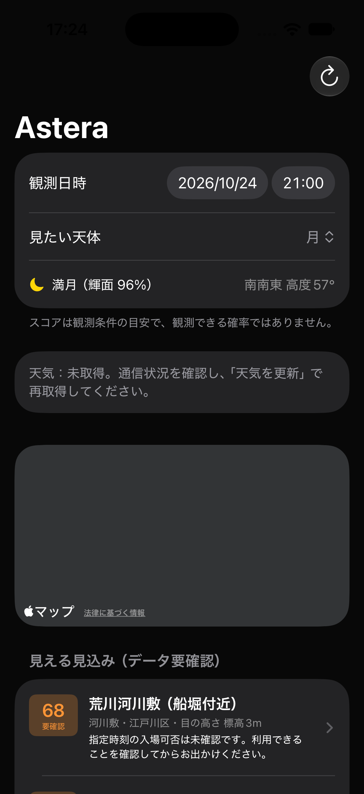

# 5-02 通信できないときの表示

2026-10-24 に確認。

## 使う人から見た動き

- 天気の取得に失敗すると、一覧に「天気：未取得」と再取得の案内を表示する。
- 一部地域だけ失敗した場合は「一部の地点」と表示し、成功した地域の予報は使う。
- 失敗した地域の古い予報は消し、詳細画面は既存の「未取得」表示になる。
- 地点一覧・天体計算は引き続き使える。更新終了後は再度「天気を更新」を押せる。
- 通信の待ち時間は15秒。同時に更新を重ねて実行しない。

## 自動テスト

```sh
swift test --package-path Packages/StarCore
python3 scripts/test_weather_offline.py
```

既存の60テストと、AppModelの4テスト（引数違いを含む5ケース）が成功。
追加テストは Swift Testing を使い、AppModel を一時的なテスト用パッケージにコピーして実行する。
実際のネット通信はせず、URLProtocol と保存済みの予報データで再現する。

1. 通信できない状態で起動しても、地点と予測を維持し、天気は未取得になる。
2. タイムアウト・HTTP 503でも読み込みが終了する。
3. 一部地域の失敗は他地域の取得成功を妨げない。
4. 再取得が成功すると案内が消えて予報を使え、次の失敗では古い予報を消す。

## シミュレータ

iPhone 17 / iOS 27.0で通常ビルド成功。
通信部分のみ一時的に `URLError(.notConnectedToInternet)` を返す検証用ビルドを作成して起動し、
「未取得」の案内・更新ボタン・地点一覧が表示されることを確認した。
この差し替えは検証後に取り除き、製品コードには含めていない。



指定の iPhone 17 Pro はこの環境に無く、指定コマンドは実行先なしで失敗したため iPhone 17 で代替。
実機の機内モード操作・実機での詳細画面の確認は未実施。
